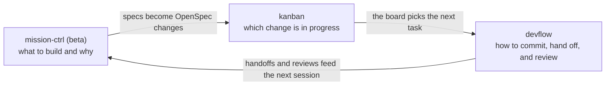

# sdlc-tools

A Claude Code plugin marketplace for the software development loop. It holds three plugins that work together:

| Plugin | Status | What it does |
| --- | --- | --- |
| [devflow](devflow/README.md) | Stable | Adds commit, handoff, and review workflows as skills. |
| [kanban](kanban/README.md) | Stable | Keeps a `kanban.yaml` task board in sync with OpenSpec changes. Shows a live board pane inside Claude Code. |
| [mission-ctrl](mission-ctrl/README.md) | **Beta** | Keeps a git-tracked record of intent (mission, backlog, specs, design gate) and guides each session from it. |

## How the plugins work together



- **mission-ctrl** captures ideas, triages them, and turns them into specs. A design gate must pass before you start to build. A hook gives a recap at the start of each session.
- **kanban** tracks OpenSpec changes on a board with the lanes Not Started, In Progress, and Archived.
- **devflow** plans atomic commits, saves and restores session handoffs, and runs a gated self-review before you push.

devflow lists kanban as a dependency, so an install of devflow also installs kanban. mission-ctrl has no dependency on the other two. You can install it alone.

## Install

Register the marketplace one time:

```bash
claude plugin marketplace add qcom-all-gh-users/sdlc-tools
```

Install each plugin per project, at local scope:

```bash
# devflow also needs the ponytail marketplace for one of its dependencies
claude plugin marketplace add DietrichGebert/ponytail
claude plugin install devflow@sdlc-tools --scope local

claude plugin install kanban@sdlc-tools --scope local

claude plugin install mission-ctrl@sdlc-tools --scope local
```

Inside a Claude Code session, you can use `/plugin marketplace add ...` and `/plugin install ...` instead.

### Prerequisites

| Plugin | Needs |
| --- | --- |
| devflow | `superpowers` (from `claude-plugins-official`) and `ponytail` (from `DietrichGebert/ponytail`). Claude Code installs them as dependencies. |
| kanban | Node.js and npm. A project that is a git repository. |
| mission-ctrl | Python 3.11+ and [uv](https://docs.astral.sh/uv/) on PATH. The plugin runs its Python code through `uv`. |

## mission-ctrl is in beta

mission-ctrl is in beta testing. Skills, hooks, and the `.mission/` file format can change between releases. Its `UserPromptSubmit` hook blocks prompts that ask to implement something before a spec exists. Type `override intent` in the prompt to continue. Report problems with `/mission-ctrl:log-feedback` or as a GitHub issue.

## Move from the old marketplaces

Each plugin had its own marketplace before: `devflow`, `kanban`, and `mission-ctrl`. Those repos are archived and point here. To switch:

1. Run `claude plugin marketplace list` to see which old marketplaces you have.
2. Run `claude plugin marketplace remove <old-name>` for each old one. This also uninstalls the plugins from that marketplace.
3. Add `sdlc-tools` and install the plugins again with the commands above.

Remove the old marketplace first. If both stay, two copies of a plugin with the same name can load.

## Repository layout

```
sdlc-tools/
├── .claude-plugin/marketplace.json   # lists the three plugins
├── devflow/                          # plugin root: devflow/
├── kanban/                           # project; plugin root: kanban/plugins/kanban/
└── mission-ctrl/                     # plugin root: mission-ctrl/ (includes the Python packages)
```

Each folder keeps its full git history from its old repo. Release tags use the form `<plugin>--v<version>`, for example `devflow--v0.3.0`.

To validate after a change:

```bash
claude plugin validate .
claude plugin validate ./devflow
claude plugin validate ./kanban/plugins/kanban
claude plugin validate ./mission-ctrl
```

See [docs/decisions.md](docs/decisions.md) for the decisions behind this layout.
