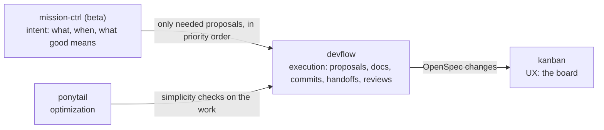

# sdlc-tools

A Claude Code plugin marketplace for the software development loop. It holds three plugins that work together:

| Plugin | Status | What it does |
| --- | --- | --- |
| [devflow](devflow/README.md) | Stable | Adds commit, handoff, and review workflows as skills. |
| [kanban](kanban/README.md) | Stable | Keeps a `kanban.yaml` task board in sync with OpenSpec changes. Shows a live board pane inside Claude Code. |
| [mission-ctrl](mission-ctrl/README.md) | **Beta** | The intent layer. Decides what to build and in which order, before devflow builds it. |

## How the plugins work together

Each tool owns one layer. A layer does not take over the job of another layer.

| Layer | Tool | Job |
| --- | --- | --- |
| Intent | mission-ctrl (beta) | Decide what to build, when to build it, and what "good" means. |
| Execution | devflow | Do the work: create proposals, manage docs, plan commits, write handoffs, and run reviews. |
| Optimization | ponytail (a devflow dependency) | Keep the code that devflow produces small and simple. |
| UX | kanban | Show the state of the work on a board. |



### Intent layer: mission-ctrl

mission-ctrl is a gate before the work starts. ponytail acts after the fact: it trims code that is already being written. mission-ctrl acts earlier, when you choose what to build.

- **A proposal you do not need is never created.** mission-ctrl judges each idea against the mission and the MVP before it becomes an OpenSpec proposal.
- **A good-to-have proposal is created, but ranked low.** When you ask what is next, it does not show up while more important proposals are open.
- **mission-ctrl remembers rejected ideas,** so the agent does not propose them again.

This layer is useful only if its judgment beats what a capable agent already does with a short mission statement. A spike tests this before more mission-ctrl code is built. The current mission-ctrl skills do not yet work this way. See [mission-ctrl is in beta](#mission-ctrl-is-in-beta).

### Execution layer: devflow

devflow wires the daily work together. It creates OpenSpec proposals, keeps working docs in `.devflow/`, plans atomic commits, saves and restores handoffs, and runs a gated self-review before you push.

### Optimization layer: ponytail

ponytail pushes for the smallest solution that works. devflow installs it as a dependency.

### UX layer: kanban

kanban tracks OpenSpec changes on a board with the lanes Not Started, In Progress, and Archived. It shows a live board pane inside Claude Code. It shows the work. It does not decide the priority.

devflow lists kanban as a dependency, so an install of devflow also installs kanban. mission-ctrl has no dependency on the other two today. You can install it alone.

## Install

Register the marketplace one time:

```bash
claude plugin marketplace add qcom-all-gh-users/sdlc-tools
```

Install each plugin per project, at local scope. OpenSpec is not a plugin, so no marketplace step exists for it. See [Prerequisites](#prerequisites).

```bash
# devflow also needs the ponytail marketplace for one of its dependencies
claude plugin marketplace add DietrichGebert/ponytail
claude plugin install devflow@sdlc-tools --scope local

claude plugin install kanban@sdlc-tools --scope local

claude plugin install mission-ctrl@sdlc-tools --scope local
```

Inside a Claude Code session, you can use `/plugin marketplace add ...` and `/plugin install ...` instead.

### Prerequisites

| Plugin | Needs |
| --- | --- |
| devflow | `superpowers` (from `claude-plugins-official`) and `ponytail` (from `DietrichGebert/ponytail`). Claude Code installs them as dependencies. |
| kanban | Node.js 22.12+ and the [OpenSpec](https://github.com/Fission-AI/OpenSpec) CLI (`npm install -g @fission-ai/openspec@latest`). A project that is a git repository. Run `/kanban:kanban-setup` after the install. It asks before it installs the CLI, then runs `openspec init`, which adds the `/openspec-*` skills to the project. |
| mission-ctrl | Python 3.11+ and [uv](https://docs.astral.sh/uv/) on PATH. The plugin runs its Python code through `uv`. |

## mission-ctrl is in beta

mission-ctrl is in beta testing. Skills, hooks, and the `.mission/` file format can change between releases. Today it keeps its own backlog, specs, and design gate in `.mission/`, and a hook gives a recap at the start of each session. These skills will change to match the intent layer above. Report problems with `/mission-ctrl:log-feedback` or as a GitHub issue.

## Move from the old marketplaces

devflow and kanban had their own marketplaces before, named `devflow` and `kanban`. mission-ctrl had no marketplace. You loaded it with `--plugin-dir`. The old repos are archived and point here. To switch:

1. Run `claude plugin marketplace list` to see which old marketplaces you have.
2. Run `claude plugin marketplace remove <old-name>` for each old one. This also uninstalls the plugins from that marketplace.
3. Add `sdlc-tools` and install the plugins again with the commands above.

Remove the old marketplace first. If both stay, two copies of a plugin with the same name can load.

## Repository layout

```
sdlc-tools/
├── .claude-plugin/marketplace.json   # lists the three plugins
├── devflow/                          # plugin root: devflow/
├── kanban/                           # project; plugin root: kanban/plugins/kanban/
└── mission-ctrl/                     # plugin root: mission-ctrl/ (includes the Python packages)
```

Each folder keeps its full git history from its old repo. Release tags use the form `<plugin>--v<version>`, for example `devflow--v0.3.0`.

To validate after a change:

```bash
claude plugin validate .
claude plugin validate ./devflow
claude plugin validate ./kanban/plugins/kanban
claude plugin validate ./mission-ctrl
```

See [docs/decisions.md](docs/decisions.md) for the decisions behind this layout.
