# devflow

A Claude Code plugin that wires your project, commit, handoff, and review workflows into every project where you install it.

## The workflow

Without devflow, an AI coding session has no memory of previous sessions, no fixed finish line, no rules about how commits are structured, and no process for review feedback. You type the same instructions into every prompt.

devflow puts these rules in skills and hooks. It has four loops:

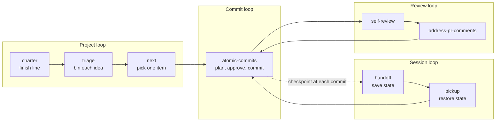

| Loop | What it does |
|---|---|
| **Project** | `charter` fixes the finish line in `.devflow/charter.md`. `triage` puts each new idea in a bin (`mvp`, `nice-to-have`, `out-of-scope`) on the kanban board, after you confirm. `next` recommends one item and a runner-up. They recommend; you decide. |
| **Commit** | Before any code, `atomic-commits` proposes a commit plan and waits for approval. It applies merge rules (config and the code that reads it go together; a refactor and a bug fix do not), runs a volume check, and offers a combine pass before a push. |
| **Session** | Each session starts with the workflow map, the charter digest, and a pointer to the latest handoff. At each milestone, a checkpoint hook asks Claude to keep the handoff current. `pickup` restores it in the next session. |
| **Review** | `self-review` runs the built-in code review, verifies each finding, checks earlier decisions, rates each fix, and waits for your approval tier by tier. `address-pr-comments` does the same for GitHub review threads. |

## What makes this stick

The value is in the process rules, not in any single skill: the merge test, the approval gates, the report format, the rating rubric, the rule that an earlier handoff overrides a reviewer's finding. These rules live in the skills, not in a prompt you retype each session.

devflow follows one principle: **hooks decide when, the main agent decides what.** A hook uses cheap, fixed signals (a commit, a new plan file) to pick the moment. The session agent, which has the full context, makes the call.

The plugin brings three dependencies:

| Dependency | Marketplace | Used for |
|---|---|---|
| `superpowers` | `claude-plugins-official` | Brainstorming, plans, debugging, and the receiving-code-review context |
| `ponytail` | `ponytail` | The smallest change that works |
| `kanban` | `sdlc-tools` | The board that holds ideas and OpenSpec changes |

## Install

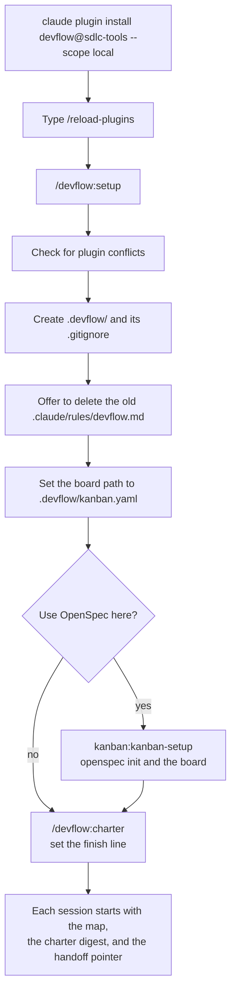

1. Run `claude plugin install devflow@sdlc-tools --scope local`. This also installs `superpowers`, `ponytail`, and `kanban`.
2. In Claude Code, type `/reload-plugins`, then run `/devflow:setup`.
3. Run `/devflow:charter` to set the finish line.

If the marketplaces are not registered yet:

```bash
# One time: register the marketplaces
claude plugin marketplace add qcom-all-gh-users/sdlc-tools
claude plugin marketplace add DietrichGebert/ponytail

# Per project
claude plugin install devflow@sdlc-tools --scope local
```

If you already have `superpowers`, `ponytail`, or `kanban` installed from a **different** marketplace, uninstall them first. `/devflow:setup` checks this for you.

Run setup again after a plugin update, and once in each new git worktree.

## Skills

| Skill | Loop | What it does |
|---|---|---|
| `setup` | — | Conflict check, marketplace registration, install, `.devflow/` folder, OpenSpec |
| `charter` | Project | Write or change the goal, done means, process, and scope |
| `triage` | Project | Propose a bin for a new idea and add it to the board |
| `next` | Project | Recommend one next item and a runner-up |
| `atomic-commits` | Commit | Plan, approve, commit, and review, one unit at a time |
| `handoff` | Session | Write or update this session's handoff |
| `pickup` | Session | Restore from the latest handoff |
| `self-review` | Review | Run, verify, rate, and gate-approve fixes from a code review |
| `address-pr-comments` | Review | Fetch, verify, rate, and gate-approve fixes from PR review threads |

## How the pieces connect

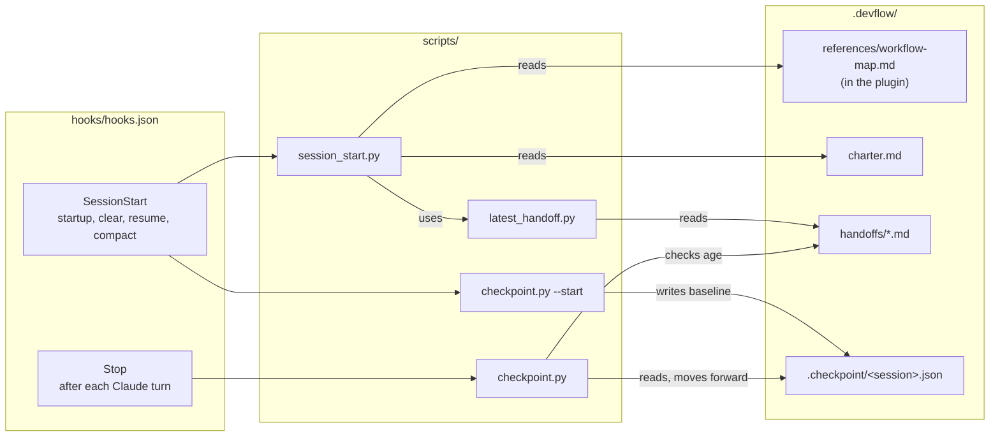

All scripts use the Python standard library only. On any error, each hook prints nothing and exits 0. The hooks need `python3` on `PATH`.

## Working files

devflow keeps its working files in `.devflow/` at the root of each git worktree, so they never mix with a project's own `docs/`. `/devflow:setup` creates the folder. The skills also create it when it is missing.

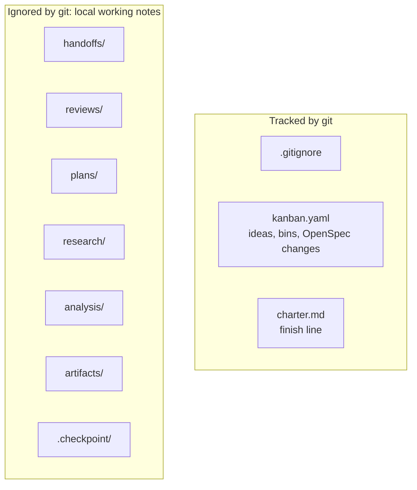

| Path | Contents | Git |
|---|---|---|
| `.devflow/kanban.yaml` | Kanban board (created by `/kanban:kanban-setup` or `/devflow:triage`) | Tracked |
| `.devflow/charter.md` | Project charter (created by `/devflow:charter`) | Tracked |
| `.devflow/handoffs/` | Handoffs | Ignored |
| `.devflow/reviews/` | Review reports | Ignored |
| `.devflow/plans/` | Plans and design specs, including superpowers plans and specs | Ignored |
| `.devflow/research/` | Research notes | Ignored |
| `.devflow/analysis/` | Analysis and root-cause notes | Ignored |
| `.devflow/artifacts/` | PDFs, diagrams, images, and other binary files | Ignored |
| `.devflow/.checkpoint/` | Checkpoint state, one file per session | Ignored |

`.devflow/.gitignore` holds four lines:

```gitignore
*
!.gitignore
!kanban.yaml
!charter.md
```

You do not need to edit your root `.gitignore`. A root pattern such as `.devflow/` blocks the `!` lines, because git cannot re-include a file inside an excluded folder. Setup finds this case and names the pattern.

The board and the charter go stale slowly, and their history explains past decisions. The other files go stale fast, and an agent that searches them acts on stale facts. So they stay local.

## Workflow map

At each session start, clear, resume, and compaction, `session_start.py` gives Claude three parts:

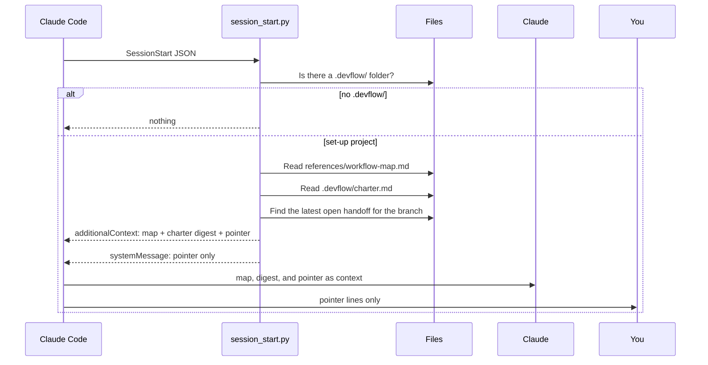

| Part | Source | Size |
|---|---|---|
| Workflow map: where files go, and which skill to use when | `references/workflow-map.md` | 40 lines at most |
| Charter digest: Goal, Done means, Process, Out of scope | `.devflow/charter.md` | 8 lines per section at most |
| Handoff pointer | the latest open handoff for the branch | 3 lines at most |

With no charter, the digest is one line that tells Claude to offer `/devflow:charter` once.

The map says *when*; each skill says *how*. A sample of the map:

| Moment | Use |
|---|---|
| The user brings a new idea or feature request | `devflow:triage`, before any design work |
| The user asks what to do next, or an item is done | `devflow:next` |
| Design a feature or a change in behavior | `superpowers:brainstorming`, then `superpowers:writing-plans` |
| Write code | `devflow:atomic-commits`, with `ponytail` |
| A bug, a test failure, or unexpected behavior | `superpowers:systematic-debugging` |
| Before a push | `devflow:self-review` |

The plugin prints the map, so a plugin update changes it in every project with no copy to refresh. If your `CLAUDE.md` names another location for a kind of file, your `CLAUDE.md` wins. Older versions copied a rule to `.claude/rules/devflow.md`. Setup offers to delete that copy.

## Project loop: charter, triage, and next

### Charter

`/devflow:charter` interviews you, one question at a time, with a draft answer for each. It writes `.devflow/charter.md` only after you approve the full file.

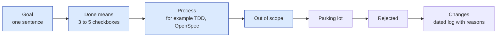

The session start digest prints the four blue sections. Each change to Goal, Done means, or Out of scope adds a dated line with your reason under Changes. So when the finish line moves, the move is visible.

### Triage

`/devflow:triage` runs when you bring a new idea, also when you say "we should also add...".

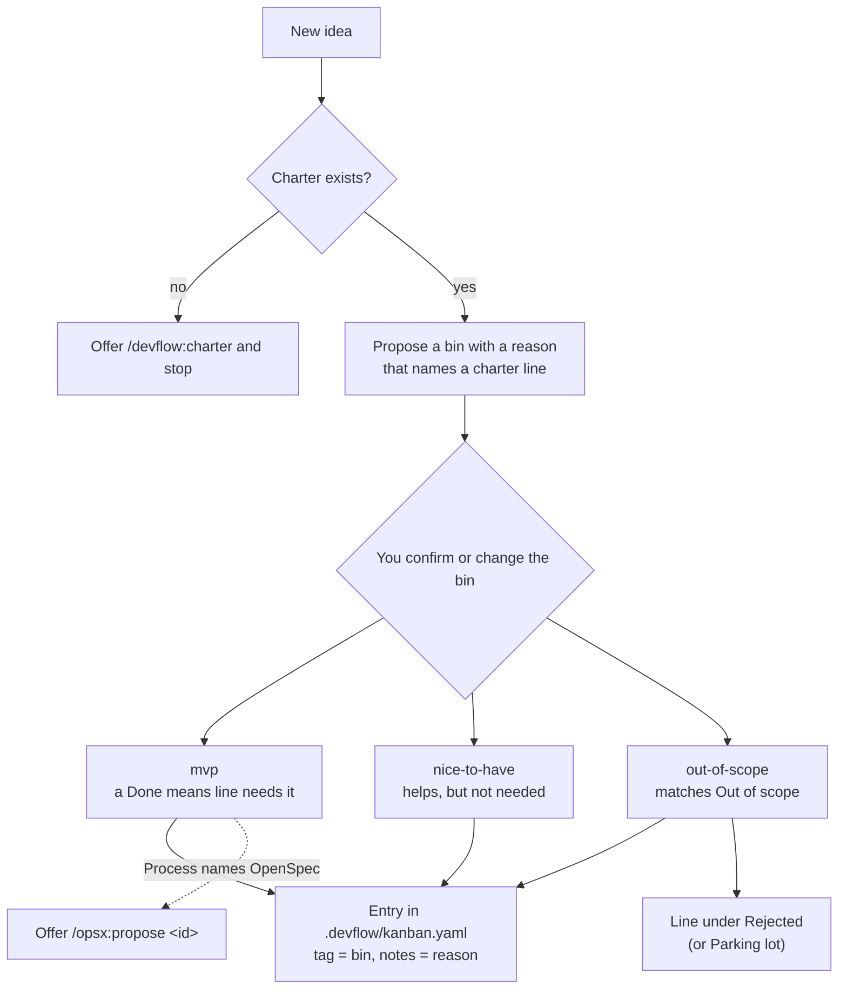

The entry `id` is kebab-case, so it can become the OpenSpec change name. When that change appears, kanban sync keeps the entry's tags and notes. Triage never refuses or delays work on an idea because of its bin.

### Next

`/devflow:next` reads the charter, the board, the open handoffs, the open OpenSpec changes, and git. It gives one item, the "Done means" line it moves, and one runner-up.

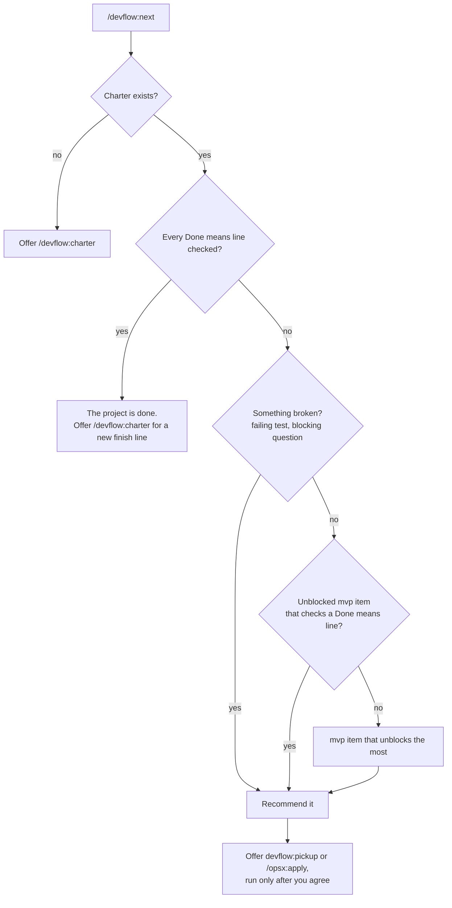

`nice-to-have` items show only when no `mvp` item is open. `out-of-scope` items never show.

## Handoff and pickup

`/devflow:handoff` writes the session state to `.devflow/handoffs/handoff_<slug>_<YYYYMMDD-HHMM>.md` in the project root. On a feature branch, `<slug>` is the branch name with `/` changed to `-`. On `main`, it is a short topic. The file starts with frontmatter (`branch`, `head`, `base`, `pr`, `status`, `session`, `summary`, `next`), so tools can find it without a pasted path.

There is one handoff per session. Each later run in the same session finds the file by its `session` key and rewrites it in place. The handoff is a snapshot, not a log:

| Section | Holds |
|---|---|
| Goal | What the work is for |
| State | At most 3 outcomes |
| Decisions | Each decision and its reason |
| Dead ends | What failed and why |
| Open questions | Each question with its context |
| Next steps | A numbered list; the first item matches `next` |
| Artifacts | Paths that git does not show |

It never lists commits or files, because pickup reads those from git. Its test for each line: "Can `git log` or `git diff` tell the reader this? If yes, delete the line."

The life of one session:

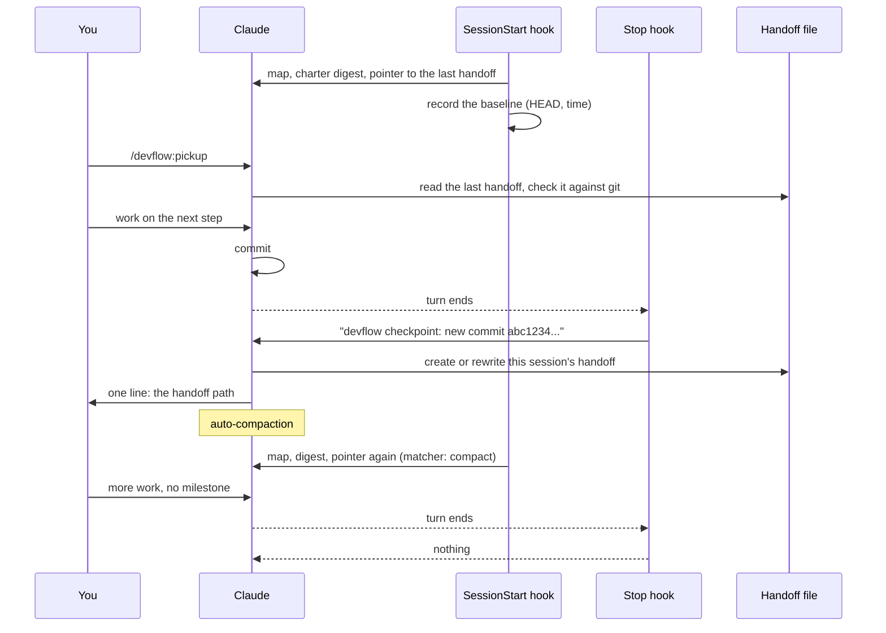

When a session starts, clears, resumes, or compacts, the pointer shows at most 3 lines: the `summary`, the `next` step, and the path of the most recently updated handoff for the current branch whose `status` is not `done`. Run `/devflow:pickup` to read that handoff, check it against git, and choose the next step. Pass a path to pick up a specific file: `/devflow:pickup .devflow/handoffs/<file>.md`.

### Checkpoint

When Claude ends a turn, the `Stop` hook checks for a milestone since the last checkpoint:

| Signal | Example |
|---|---|
| A new commit | Claude commits a fix |
| A new or changed file in `.devflow/plans/`, `analysis/`, `research/`, or `reviews/` | A plan or review report is written |
| An OpenSpec change archived, or with every task checked | The last task of a change is done |

Uncommitted edits, context use, and elapsed time are not signals. The handoffs folder is not a signal, so a handoff update does not trigger a new request.

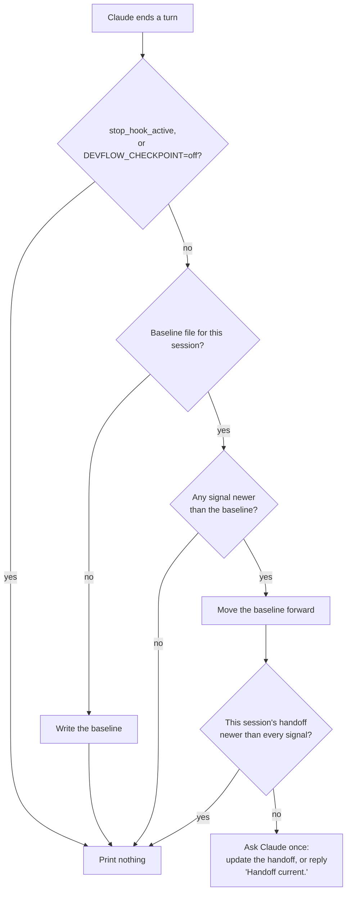

You do not need to answer the request. The hook moves the baseline before it asks, so it never asks twice for the same signal. It never asks while Claude is already continuing for it, and it stays silent on any error.

The hook keeps its state in `.devflow/.checkpoint/`. To turn it off, set `DEVFLOW_CHECKPOINT=off` in the environment. It needs Claude Code 2.1.314 or later.

## Review

Both review skills share one loop, in `references/review-loop.md`.

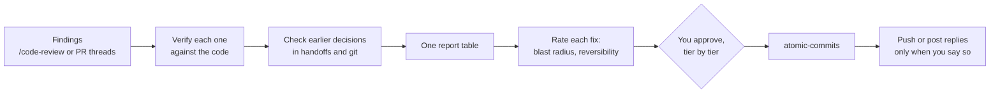

| Skill | Input | Report |
|---|---|---|
| `/devflow:self-review` | The built-in `/code-review` on your PR, unpushed commits, or `<default branch>...HEAD` | `.devflow/reviews/review_<slug>_<YYYYMMDD>.md` |
| `/devflow:address-pr-comments` | Inline threads, review bodies, and general comments on a PR | `.devflow/reviews/review_pr<n>_<YYYYMMDD>.md` |

Both skills are safe to re-run on the same target. A re-run reuses the newest report, adds a `## Round <n>` note, and adds no duplicate rows, commits, or replies. Thread replies state only facts: `**Fixed** in <sha>: <what changed>. <file>:<line>`, or `**Rejected**: <reason>`.

## Rollback

```bash
claude plugin uninstall devflow@sdlc-tools --scope local
```
