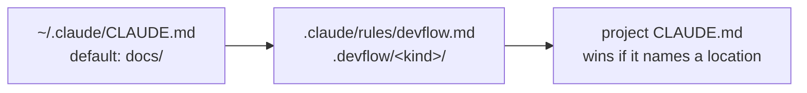

# devflow

A Claude Code plugin that wires your commit, handoff, and review workflows into every project where you install it.

## The workflow

Without devflow, an AI coding session has no memory of previous sessions, no rules about how commits are structured, and no process for handling review feedback. You type the same instructions into every prompt.

devflow changes that by composing three loops that run automatically:

**Commit loop** — before any code is written, `/atomic-commits` proposes a commit plan and waits for approval. It enforces merge rules (config and the code that reads it belong together; a refactor and a bug fix do not), runs a volume check, and offers a combine pass before a push. Each commit is reviewed before the next one starts.

**Session loop** — at the start of every session, a hook prints a one-line pointer to the latest handoff. `/handoff` saves the session state; `/pickup` restores it. No context is lost across compactions or restarts.

**Review loop** — `/self-review` runs the built-in code review, verifies each finding against the code, checks earlier decisions in handoffs and commit history, rates each proposed fix by blast radius and reversibility, and waits for your approval tier by tier before changing anything. `/address-pr-comments` does the same for GitHub review threads.

The three loops compose: a task starts with a commit plan, produces handoffs as it progresses, and ends with a review before the branch is pushed.

## What makes this stick

The value is not any single skill — it is the encoded process rules. The merge test, the approval gates, the report format, the rating rubric, the decision that an earlier handoff overrides a reviewer's finding — these are specific, tested rules that live in the skills, not in a prompt you retype each session. Install devflow once per project and the rules travel with the repo.

The plugin brings `superpowers`, `ponytail`, and `kanban` as dependencies. `superpowers` provides the receiving-code-review and executing-plans contexts the review loop calls. `ponytail` enforces simplicity discipline on code the commit loop produces. `kanban` tracks tasks on a shared board.

## Install

Run `/setup` in a Claude Code session inside the project. It checks for conflicts, registers the marketplace, and installs the plugin.

Or manually:

```bash
# One time — register the marketplaces
claude plugin marketplace add qcom-all-gh-users/devflow
claude plugin marketplace add DietrichGebert/ponytail
claude plugin marketplace add qcom-all-gh-users/kanban

# Per project
claude plugin install devflow@devflow --scope local
```

If you already have `superpowers`, `ponytail`, or `kanban` installed from a **different** marketplace, uninstall them first. `/setup` checks this for you.

## Skills

| Skill | Loop | What it does |
|---|---|---|
| `setup` | — | Conflict check, marketplace registration, install, `.devflow/` folder, project rule |
| `atomic-commits` | Commit | Plan → approve → commit → review, one unit at a time |
| `handoff` | Session | Save session state to a dated file |
| `pickup` | Session | Restore from the latest handoff |
| `self-review` | Review | Run, verify, rate, and gate-approve fixes from a code review |
| `address-pr-comments` | Review | Fetch, verify, rate, and gate-approve fixes from PR review threads |

## Working files

devflow keeps its working files in `.devflow/` at the root of each git worktree, so they never mix with a project's own `docs/`. `/devflow:setup` creates the folder. The skills also create it when it is missing.

| Folder | Contents |
|---|---|
| `.devflow/handoffs/` | Handoffs |
| `.devflow/reviews/` | Review reports |
| `.devflow/plans/` | Plans and design specs, including superpowers plans and specs |
| `.devflow/research/` | Research notes |
| `.devflow/analysis/` | Analysis and root-cause notes |
| `.devflow/artifacts/` | PDFs, diagrams, images, and other binary files |
| `.devflow/kanban.yaml` | Kanban board (created by `/kanban:kanban-setup`) |

`.devflow/.gitignore` holds `*`, so git ignores the whole folder. You do not need to edit your root `.gitignore`.

Setup also copies a rule to `.claude/rules/devflow.md`. Claude Code loads every `.claude/rules/*.md` file next to `CLAUDE.md`, so the rule reaches Claude without any edit to your `CLAUDE.md`. The rule tells Claude where each kind of file goes. If your `CLAUDE.md` names another location, your `CLAUDE.md` wins. Setup asks before it adds the rule file to `.git/info/exclude`. Run setup again after a plugin update to refresh the rule, and once in each new worktree.



## Handoff and pickup

`/handoff` writes the session state to `.devflow/handoffs/handoff_<slug>_<YYYYMMDD-HHMM>.md` in the project root. On a feature branch, `<slug>` is the branch name with `/` changed to `-`. On `main`, it is a short topic. The file starts with frontmatter (`branch`, `head`, `base`, `pr`, `status`, `next`), so tools can find it without a pasted path.

When a session starts, clears, or resumes, a hook prints one line. The line names the newest handoff for the current branch whose `status` is not `done`, and its `next` step. Run `/devflow:pickup` to read that handoff, check it against git, and choose the next step. Pass a path to pick up a specific file: `/devflow:pickup .devflow/handoffs/<file>.md`.

The hook needs `python3` on `PATH`.

## Review

Both review skills share one loop, in `references/review-loop.md`. It verifies each finding, checks it against earlier decisions, writes one report table, rates each fix, and stops for your approval. Approved fixes go through `atomic-commits`. Nothing is pushed or posted until you say so.

| Skill | Input | Report |
|---|---|---|
| `/devflow:self-review` | The built-in `/code-review` on your PR, unpushed commits, or `<default branch>...HEAD` | `.devflow/reviews/review_<slug>_<YYYYMMDD>.md` |
| `/devflow:address-pr-comments` | Inline threads, review bodies, and general comments on a PR | `.devflow/reviews/review_pr<n>_<YYYYMMDD>.md` |

Both skills are safe to re-run on the same target. A re-run reuses the newest report, adds a `## Round <n>` note, and adds no duplicate rows, commits, or replies. Thread replies state only facts: `**Fixed** in <sha>: <what changed>. <file>:<line>`, or `**Rejected**: <reason>`.

## Rollback

```bash
claude plugin uninstall devflow@devflow --scope local
```
