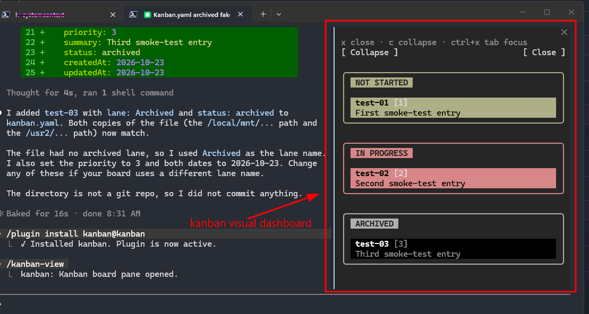

# OpenSpec Kanban Bridge

A plugin that bridges OpenSpec spec-driven development with lightweight kanban task management. It keeps your task board in sync with your specs so you always know what to work on next.

The plugin also installs as a **Claude Code mod** — a live kanban pane that docks inside your existing Claude Code session. Run `/kanban-view` to open it. No browser required.



## How It Works

1. You propose an OpenSpec change → the board adds it to "Not Started" automatically.
2. You start working → move the card to "In Progress".
3. You archive the spec → the board moves it to "Archived" automatically.

The board gives you a quick overview of current project status based on OpenSpec proposal statuses.

## Features

- **`kanban.yaml`** at project root — human-editable YAML with priority, status, lane, and metadata per entry.
- **`kanban.html`** — a generated visual board from `/kanban-render`.
- **Skills** — `/kanban-view`, `/kanban-sync`, `/kanban-render`, `/kanban-init`, plus OpenSpec skills (`/openspec-propose`, `/openspec-apply-change`, `/openspec-archive-change`, `/openspec-explore`, `/openspec-sync-specs`).
- **Auto-sync** — the pane refreshes when `kanban.yaml` changes, when new proposals appear, and after kanban commands.
- **Setup dialog** — `/kanban:setup` calls the mod tool `kanban_board_setup`. It opens a Yes/No dialog to create or sync `kanban.yaml`. The first call shows one permission prompt.

## Installation (Claude Code)

### Prerequisites

- Node.js and npm.
- A project directory that is a git repository.

### 1. Install the plugin

Run these commands inside Claude Code, in your project:

```
/plugin marketplace add qcom-all-gh-users/kanban
/plugin install kanban@kanban
```

The install writes an `enabledPlugins` entry to `.claude/settings.json`. Each contributor runs these commands once.

### 2. Run setup

```
/kanban:setup
```

Setup does five things:

1. Install `@fission-ai/openspec` with `npm install`.
2. Build `libs/kanban-core`.
3. Run `npx openspec init` if the project has no `openspec/config.yaml`.
4. Ask you to create or sync `kanban.yaml` in a Yes/No dialog.
5. Print a one-line summary.

Claude Code asks for permission the first time it calls the `kanban_board_setup` tool. Allow it.

### 3. Open the board

```
/kanban-view
```

The side pane docks beside the transcript only in fullscreen mode. Run `/tui fullscreen`, or start Claude Code with `CLAUDE_CODE_NO_FLICKER=1`. In the classic renderer, the pane opens above the prompt.

### Update

Run `/plugin marketplace update kanban`, then `/kanban:setup` again. Setup is safe to repeat.

## Pane Controls

| Key | Action |
|-----|--------|
| `x` | Close the pane |
| `c` | Collapse / expand lane cards |
| Esc | Close the pane |

## Lane Colors

| Lane | Color |
|------|-------|
| Not Started | cyan |
| In Progress | yellow |
| Archived | dim gray |

Each entry shows a bold ID, a bracketed priority number, and a dim summary line.

## Contributing

See [CONTRIBUTING.md](CONTRIBUTING.md).

## Planned Support

Support for [OpenCode](https://opencode.ai) is planned.

## License

MIT
