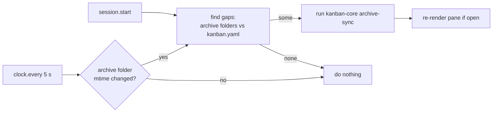

## Why

After a change is archived, the kanban pane still shows it in its old lane. Nothing writes `docs/kanban.yaml` when an archive happens:

1. The `openspec-archive-change` skill moves the change folder and runs `openspec archive`. It does not touch `docs/kanban.yaml`. We do not own that skill, so an edit to it is lost on the next OpenSpec update.
2. A person can also run `openspec archive <name>` in a plain terminal. No Claude Code event fires for that.
3. The mod's `command.run` hooks for `opsx-archive` and `opsx-propose` never fire in Claude Code. Those names exist only in `.opencode/commands/`.

The `kanban-14` auto-sync only re-renders the pane. It does not write the file. So the pane re-renders the same old data.

## What Changes

- The mod watches `openspec/changes/archive/` for new folders. It checks the folder's `mtimeMs` with `$.fs.stat` on a `$.clock.every` timer (5 s), and once at `session.start`.
- When the folder changes, the mod compares the archived change names with `docs/kanban.yaml`. A **gap** is an archived change whose board entry is not in the `Archived` lane, or has no entry.
- For each gap, the mod runs a new targeted kanban-core command: `node libs/kanban-core/dist/src/cli.js archive-sync`. That command moves gap entries to `Archived` and sets `status`, `specPath`, `archivedAt`, `completedAt`, and `updatedAt`. It leaves all other entries and fields as they are.
- After the write, the mod re-renders the pane if it is open.
- If the command fails, the mod shows one `$.ui.toast` with the error. It does not retry until the archive folder changes again.
- Remove the dead `opsx-archive` and `opsx-propose` names from the `command.run` list.

## Decisions

### Poll the folder, not a per-turn event

The person archives in two ways: through Claude (the skill) and from a plain terminal. A per-turn event such as `turn.complete` sees only the first way. A timer sees both. The Claude Code status line works the same way: it updates on events, and its `refreshInterval` setting adds a timer for changes made "while the main session is idle" ([status line docs](https://code.claude.com/docs/en/statusline)).

One `stat` of one folder every 5 s costs almost nothing. The full scan runs only when the folder's `mtimeMs` changes. Adding a folder entry changes the parent folder's `mtimeMs`, and `openspec archive` adds one.

| Trigger | Archive by skill | Archive from terminal | Cost |
| --- | --- | --- | --- |
| `command.run` (current) | No (wrong names) | No | None |
| `tool.call` on `Bash` | Only if the skill uses Bash | No | Every Bash call |
| `turn.complete` | Yes | Only at the next turn | Once per turn |
| **`$.clock.every` + `stat`** | **Yes, within 5 s** | **Yes, within 5 s** | **One `stat` per 5 s** |

### Targeted archive-sync, not the full sync

A dry run of the current `syncFromOpenSpec` on a copy of `docs/kanban.yaml` changed 43 lines. Most changes are wrong for an automatic write:

| Found in dry run | Effect |
| --- | --- |
| `status` of active entries reset from the `openspec status` output | "code done, smoke test pending" became "tasks ready" on 4 entries |
| `completedAt` dropped from `kanban-20` | Hand-entered data lost |
| `updatedAt` set to the UTC date | On Oct 22 at 18:38 PDT, it wrote `2026-10-23` |
| `kanban-21` is in both `changes/` and `changes/archive/` | The active pass drops `archivedAt`, then the archive pass sets it to today |
| Each `openspec status` call takes about 0.5 s | 11 calls, about 6 s per sync |

The full sync is fine when the person asks for it (`/kanban-sync`) and reviews the diff. It is not fine as a silent background write. The targeted command touches only gap entries and makes no `openspec` calls. Its dates use the local date.

### kanban-core writes the file, not the mod

The mod has no YAML library and runs with no Node. kanban-core already owns `readKanban` and `writeKanban`. One writer keeps one format. `kanban-16-kanban-core-cli` adds the CLI entry point. This change adds an `archive-sync` subcommand to it.

## Implications of an automatic write

The mod writes `docs/kanban.yaml` without asking. That is different from Claude editing the file:

| | Claude edits with `Edit` / `Write` | Mod runs `archive-sync` |
| --- | --- | --- |
| Permission prompt | Yes, unless allowed | No |
| Shows in the transcript | Yes, with a diff | No (silent, like `kanban-14`) |
| `/rewind` can undo it | Yes | Only if Claude edited the file before in this session. Otherwise use git. ([checkpoint docs](https://code.claude.com/docs/en/checkpointing#bash-command-changes-not-tracked)) |
| What changes | The lines Claude chooses | Gap entries only. `writeKanban` re-serializes the whole file, so YAML comments and line wrapping can change. |
| Runs when | Only during a turn | Any time, also when Claude is idle |
| Uses model tokens | Yes | No |

Other effects:

- **Git:** `docs/kanban.yaml` shows as modified after an archive. You commit it as you do now.
- **Race with Claude:** if the mod writes while Claude edits the file, Claude's `Edit` fails because the file changed since its last read. Claude then reads it again. No data is lost.
- **Same-day runs:** the write is idempotent. With no gap, nothing is written.

## Capabilities

### New Capabilities

- `claude-mod-archive-sync`: The mod finds archived changes missing from the `Archived` lane and moves them there.

### Modified Capabilities

- `kanban-core-sync`: Adds a targeted `archive-sync` command that touches only gap entries.
- `claude-mod-autosync`: Removes the `opsx-archive` and `opsx-propose` command triggers.

## User Stories

| ID | Story |
| --- | --- |
| U1 | After I archive a change through Claude, the pane shows it in Archived within 5 s. |
| U2 | After I run `openspec archive` in a terminal, the pane shows it in Archived within 5 s, with no Claude turn. |
| U3 | The auto write does not change my hand-written status, notes, priority, or dates on other entries. |
| U4 | If the write fails, I see one toast with the reason. |

## Impact

- Depends on: `kanban-16-kanban-core-cli` (CLI entry point).
- Modifies: `libs/kanban-core/src/sync.ts` (new `applyArchives` function), `libs/kanban-core/src/cli.ts` (new `archive-sync` subcommand).
- Modifies: `mod/kanban-board/hooks/register.tsx` (timer, gap scan, `$.process.run`, remove dead command names).
- Modifies: `CLAUDE.md` section "Auto-sync", and `AGENTS.md` "Archive rule" (the manual board step becomes automatic in Claude Code).
- No change to the OpenSpec skills.

## Non-Goals

- New changes missing from the board. See `kanban-25-mod-new-change-sync`.
- Re-render on manual edits to `docs/kanban.yaml` (issue 2). The same timer can `stat` that file later.
- Fix the full sync's status and date problems. Track that as its own change.

## Assumptions

- The person keeps `node` on `PATH` in the Claude Code session.
- A 5 s delay is acceptable.
- Claude Code runs from the project root, so `$.session.cwd()` holds `openspec/` and `docs/`.

## Open Questions

- `docs/kanban.yaml` holds `lane: archived` (lower case) for `kanban-18` in the working tree. The pane groups an unknown lane under Not Started. Should the gap check treat lane names without case?
