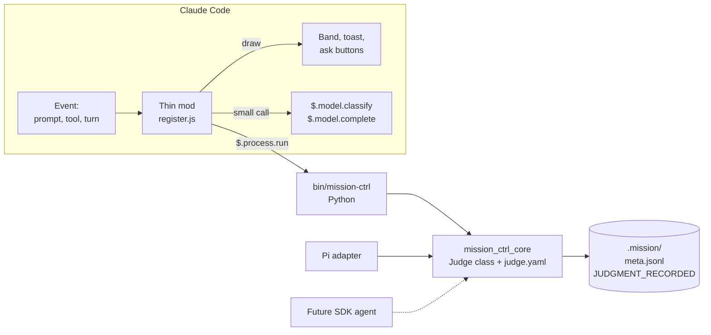

# LLM Judgment for Workflow Orchestration

**Date:** 2026-10-17 (revision 2)
**Status:** Analysis. No code changed yet.
**Related:** proposals `judgment-layer-18` to `design-gate-enrichment-22`, `docs/feedback.md` (I1–I4, F9, F11)

---

## Bottom Line

The first version of this report asked one question: where should an LLM make decisions for mission-ctrl? This version adds two questions. Do Claude Code **mods** change the answer? And should we stop extending Claude Code and build our own agent?

- **Do not build a custom agent now.** mission-ctrl is a control layer that sits on a harness. It is not a harness. Claude Code now gives that layer more hooks than any other option we have.
- **Mods are the biggest change since revision 1.** A mod can add context to a prompt, hold a tool call, call a small model, draw a status band, and run a command without a Claude turn. Four of our gaps map directly onto these features.
- **Keep Python as the brain. Use a thin mod as the hands.** The mod catches events and draws UI. It calls `bin/mission-ctrl` for every store read and write. The core stays host-agnostic, so the Pi adapter and a future SDK agent can still use it.
- **Use three more built-in features:** `/goal` for "work this spec until done", `claude plugin eval` for the test set, and dynamic workflows for ranking a large backlog.
- **Two blockers need your decision.** Mods are JavaScript, and constraint `con_002` says "No Node.js in the runtime path". Mods also need Claude Code v2.1.287 or later. This machine runs v2.1.280.

---

## Background: What We Are Solving

mission-ctrl keeps a record of what you intend to build. It holds the mission, the MVP, the backlog, and the specs. Today it moves that record forward with fixed rules. Dogfooding showed four places where a rule is not enough.

| # | Decision | What goes wrong today | Evidence |
|---|---|---|---|
| 1 | **Order**: which change goes first | Dependencies exist only if a person types them. | I1 |
| 2 | **Criticality**: does this serve the mission | The triage verdict is free text. Nothing checks it against the mission. | I2 |
| 3 | **Intent**: is this prompt a request to build | Keyword match. "Build" in a design chat gets redirected. | F2, F3, I3 |
| 4 | **Advance**: is this spec done | Nothing moves a spec forward. A person must run `spec-status`. | F11, I4. spec_004–007 in e2eeval were all closed by hand. |

A fifth gap came out of this review. The design gate only checks the prompt. If Claude starts to edit files without a prompt that says "implement", nothing stops it. Mods can close this gap (see story 2).

---

## Am I Building a Harness?

This question decides everything else, so it comes first. Anthropic defines a harness as the scaffolding around the model: the loop, the tools, context handling, and guardrails ([Harnessing Claude's intelligence](https://claude.com/blog/harnessing-claudes-intelligence)).

**Short answer: no.** mission-ctrl does not run the loop, call tools, or manage context. It decides *what work is allowed* and *what comes next*. That is a policy and memory layer. It needs a harness under it, but it does not need to be one.

The Claude Code team follows the same pattern. They built Research, Code Review, and agent teams as harnesses **on top of** Claude Code, not from scratch ([A harness for every task](https://claude.com/blog/a-harness-for-every-task-dynamic-workflows-in-claude-code)).

### Is Claude Code the best host for this?

For an interactive coding companion, yes. The table compares the options we have.

| Option | What you get | What you lose | Fit |
|---|---|---|---|
| **Claude Code + plugin + mod** | Hooks, skills, mods (prompt, tool, turn, UI events), `/goal`, workflows, plugin evals. Uses your normal login. | Mods are JS. Some features are new and can change. | **Best fit now** |
| **Agent SDK (Python)** | Full control of the loop, `max_budget_usd`, custom tools, Python hook callbacks. Loads plugins and skills. | No terminal UI of your own. The docs say products built on the SDK must use an API key, not a claude.ai login. Mods run but cannot draw. | Good later, for a headless "autopilot" mode |
| **Pi (existing adapter)** | Already works with the same core and store. | Fewer extension points than Claude Code. | Keep as second host |
| **Raw API + own loop** | Total control. | You rebuild tools, permissions, compaction, and UI. | Not worth it |

### When a custom agent would be the right call

Build on the Agent SDK only if one of these becomes true:

- You want mission-ctrl to **drive** work with no person in the loop, such as nightly triage in CI.
- You want to ship mission-ctrl to other people as its own product.
- You need control that no Claude Code event gives you.

None of these is true for the MVP. And because the SDK *is* Claude Code as a library, the plugin, skills, and hooks you build now carry over if you switch later ([Agent SDK overview](https://code.claude.com/docs/en/agent-sdk/overview)).

---

## What Is New Since Revision 1

Revision 1 used only settings hooks and `claude -p`. Claude Code now has several features that fit our loop better. This section lists them and says what each one does for us.

### Mods

A mod is a plugin with JavaScript or TypeScript event handlers. The handlers run **inside** Claude Code, so they can do things a shell hook cannot ([Mods overview](https://code.claude.com/docs/en/plugins/mods)).

| Mod feature | What it does | Which gap it fixes |
|---|---|---|
| `prompt.submit` → `context` | Adds text only Claude reads. Does not block. | 3 Intent |
| `$.model.classify(text, labels)` | One cheap call to the small fast model. Returns one label. | 3 Intent |
| `tool.check` on `Edit`/`Write` | Returns `allow`, `ask`, or `deny` before a tool runs. | 5 Gate leak |
| `turn.complete` + `$.process.run` | Runs after each turn. Can check git for `closes spec_N`. | 4 Advance |
| `$.ui.ask`, `$.ui.toast`, band above the prompt | Asks a question with buttons, or shows state, with no Claude turn. | 4 Advance, recap noise |
| `$.command.register({ immediate: true })` | A slash command that runs your code at once, even while Claude works. | Fast bookkeeping |
| `$.model.complete` | A model call with no tools and no CLAUDE.md. Bills to your session. | 1 Order, 2 Criticality |
| `turn.step` → `next({ ...e, model })` | Sends one request to a different model. | Cost routing (later) |

Important detail: `$.model.complete` replaces the `claude -p` judge from revision 1. It cannot set off our own hooks again, so risk 3 from revision 1 goes away. It also needs no API key.

Limits to know ([Mods reference](https://code.claude.com/docs/en/plugins/mods/reference)):

- A hook gets 10 s of its own time. Time spent in mods API calls, such as a model call, does not count.
- `$.process.run` times out at 30 s by default.
- The hooks module has no Node.js APIs. It reaches files and processes only through `$`.
- Mods need v2.1.287 or later.

### Other features we do not use yet

| Feature | What it does | How we use it |
|---|---|---|
| **`/goal`** | After each turn, a small model checks a condition. If the condition is not met, Claude keeps going ([docs](https://code.claude.com/docs/en/goal)). | When a spec goes `in_progress`, suggest `/goal <its acceptance criteria>`. The evaluator judges "done" for us. |
| **`claude plugin eval`** | Runs real prompts against the plugin. Grades with regex, `tool_used`, or a judge rubric. Compares against a run with no plugin ([docs](https://code.claude.com/docs/en/plugin-evals)). | This becomes our test set (Phase 5). No custom harness needed. |
| **Dynamic workflows** | A JS script runs many subagents and returns one result. Can ship in a plugin `workflows/` folder ([docs](https://code.claude.com/docs/en/workflows)). | Rank a large backlog with the "tournament" pattern. Anthropic notes that comparing two items is more reliable than scoring one. |
| **Monitors** (experimental) | A background process whose output reaches the session. | Optional. Watch git for new commits. A mod timer can do the same. |

---

## Recommendation

The judgment split from revision 1 still holds: decisions inside a live chat stay close to the chat, and decisions about the whole project go to a fresh judge. What changes is *where the code runs*. Below is the updated map.

### Where each decision runs

| # | Decision | Who judges | Mechanism | Acts on its own? |
|---|---|---|---|---|
| 3 | Intent | Small model | Mod `prompt.submit`. The keyword match stays as a cheap first filter. Only on a hit, call `$.model.classify(text, ["build", "discuss", "question"])`. On `build`, add a context note with store facts. | Yes. It never blocks. |
| 5 | Gate | Rule, no model | Mod `tool.check` on `Edit`/`Write`. If no spec is `design_approved` or `in_progress`, return `ask` with a short reason. | No. You decide each time. |
| 4 | Advance | Rule first, then you | Mod `turn.complete`. If a new commit says `closes spec_N`, show `$.ui.ask("Mark spec_N done?")`. Also suggest `/goal` when a spec starts. | Only on your click. |
| 2 | Criticality | Fresh judge | `triage` skill calls a mod tool, which calls `$.model.complete` with the mission, MVP, constraints, and idea. The Python core validates the JSON. | No. It proposes a bucket. |
| 1 | Order | Fresh judge | Same path as criticality for small backlogs. Over about 15 items, a plugin workflow runs a tournament. | No. It proposes links. |

### Design

- **The mod holds no business logic.** It catches events, asks Python what to do, and shows the result. This keeps one write path and keeps the Pi adapter working.
- **`Judge` class in core.** One method per decision type. It reads `judge.yaml` for prompts, labels, and thresholds. The mod sends it model output. The core validates it and writes a `JudgmentResult` (schema from proposal 18).
- **Fallback without mods.** If you do not approve JS, the revision 1 plan still works: command hooks with `additionalContext`, and a `Stop` hook. You lose the gate fix (5), the buttons, and the band.

---

## User Stories: Before and After

These are the moments where you feel the difference. Each story starts with something you do on a normal day. It shows what happens now, and what would happen with the plan above.

### 1. You ask a question that contains "implement"

You are thinking out loud with Claude about a feature you have not started.

- **Before:** You type "What would it take to implement the cache layer?" The keyword rule fires. mission-ctrl tells you to add an idea first. You did not ask to build anything, so the nudge is noise. (F3 fixed the `?` case, but "Let's think about how to implement X" still trips it.)
- **After:** The keyword rule fires, then the mod asks the small model: build, discuss, or question? It says `discuss`. Nothing happens. You never see mission-ctrl, which is the point.

### 2. Claude starts to edit before the design is approved

You say "go ahead and try it". The words do not match the keyword list, so Claude starts to write code.

- **Before:** Nothing stops it. The design gate only reads prompts. You find out later that the spec skipped `design-propose`.
- **After:** The first `Edit` call hits the mod's `tool.check`. You see a normal permission prompt: "No approved design for this work. Allow anyway?" You choose. If you allow it, mission-ctrl logs the override.

### 3. You finish a spec

You commit the last change for spec_004 and move on.

- **Before:** spec_004 stays `in_progress` for days. `/next` keeps it on the list. You close it by hand when you notice. This happened four times in e2eeval.
- **After:** Your commit message says `closes spec_004`. When the turn ends, a question appears: "Mark spec_004 done?" One key press closes it. No Claude turn, no tokens. If you started the spec with `/goal`, the goal evaluator already confirmed the criteria hold.

### 4. You capture an idea in the middle of other work

An idea comes to you while you fix a bug. You add it and keep going.

- **Before:** `triage` asks you for a bucket and a free-text "alignment" note. You type something quick. Nothing checks it against the mission.
- **After:** The judge reads the mission and MVP and proposes: "Parked. It helps deployment, but the MVP is about session focus." You accept or change it. The verdict and reason go into `meta.jsonl`, so you can review your triage habits later.

### 5. You ask "what next?"

You have ten minutes and want the most useful small task.

- **Before:** `/next` ranks specs only by MVP flag and declared dependencies. Ideas you never triaged do not show up. Order is whatever you typed into `depends_on`.
- **After:** `/next` shows the same ranking, plus proposed links: "spec_009 likely depends on spec_007 (both touch the store schema)." You accept a link with one key. A large backlog gets a tournament workflow that compares items in pairs.

### 6. You come back after a weekend

You open a new session on Monday morning.

- **Before:** The `SessionStart` hook writes a recap into the chat. It is useful, but it uses context every session, and it scrolls away.
- **After:** A one-line band above the prompt shows the mission, the active spec, and MVP progress. It stays visible and costs no context. The full recap is still one command away.

### 7. You change a judge prompt

You tune the intent prompt because it missed a case.

- **Before:** You test by hand in a live session and hope nothing else broke.
- **After:** You run `claude plugin eval`. The cases come from this report and the feedback log. Each case runs with and without the plugin, so you see what mission-ctrl adds. You can gate CI on the score.

---

## Trade-offs

Every choice above has a cost. This table shows the main ones and the pick.

| Choice | Option A | Option B | Pick |
|---|---|---|---|
| Where hooks live | Settings hooks (shell): Python only, but can only block or add context | Mod (JS): can hold, ask, draw, call a model | Mod, if you approve JS. Keep it thin. |
| Intent judge | Main agent reads a note: free, but adds context to every hit | `$.model.classify`: one small call, main context stays clean | Classify, behind the keyword filter |
| Outside judge | `claude -p --json-schema`: schema built in, but can re-run our hooks | `$.model.complete`: no recursion, your login, but we parse JSON ourselves | `$.model.complete`, validated in core |
| Host | Claude Code: rich hooks, your login | Agent SDK: full control, API key, no UI | Claude Code now. Keep the core ready for the SDK. |
| Autonomy | Auto: no clicks, but wrong moves pile up | Ask: safe, but slower | Auto only when easy to undo |

---

## Assumptions (please confirm)

The plan depends on these. If one is wrong, the plan changes.

1. **A thin JS mod is acceptable under `con_002`.** The rule's scope is `packages/claude-plugin/bin`, and mods run in Claude Code's own engine, not in a Node process we ship. But it is still JS in our repo. You decide.
2. You will update Claude Code to v2.1.287 or later. This machine runs v2.1.280.
3. Removing `con_001` ("No LLM calls inside core") from the working tree is intended. The plan still keeps model calls out of core: the mod makes the call, and core only validates.
4. "JEV" means a small judge → evaluate → verify loop. I found no public source for this term.
5. Proposals `store-mvp-tracking-15` and `backlog-planner-integration-16` go first. The judge needs a correct store.

---

## Risks

These are the ways the plan can fail, and how to limit each one.

| # | Risk | How to reduce it |
|---|---|---|
| 1 | Wrong verdicts | Confidence threshold. Ask below it. Log every verdict. |
| 2 | Mods API changes | Keep the mod small. Pin a minimum version. Test with `claude plugin test`. |
| 3 | Mod hook times out (10 s) | Do model and process work through `$` calls, which do not count. Fail open on intent. Fail to `ask` on the gate. |
| 4 | `tool.check` gate annoys you | Only check `Edit`/`Write`. Skip paths under `docs/` and `.mission/`. |
| 5 | Cost grows quietly | Model call only after a cheap check passes. Log `usage` per call. |
| 6 | Python start-up is slow per event | Measure `bin/mission-ctrl` start time. If it is over ~300 ms, cache store facts in `$.store` and refresh on change. |
| 7 | Two hosts drift (Claude Code vs Pi) | All rules stay in core. The mod and the Pi adapter only translate events. |

---

## Phased Plan

Each phase is small and ends with something you can see work. You need to complete Phase 0 before the judge phases.

| Phase | Work | Done when |
|---|---|---|
| 0 | Proposals 15 and 16. Update Claude Code. Decide on `con_002`. | MVP % is correct. `/next` shows ideas. |
| 1 | `Judge` class, `judge.yaml`, `JUDGMENT_RECORDED`. Empty mod that loads and calls `bin/mission-ctrl`. | One verdict saves to `meta.jsonl`. `/plugin` shows the mod active. |
| 2 | Intent (story 1) and gate (story 2) | F2/F3 prompts pass through. The first unapproved `Edit` asks. |
| 3 | Advance (story 3) and the band (story 6) | A `closes spec_N` commit offers to close it. The band shows the active spec. |
| 4 | Criticality and order (stories 4, 5) | Triage proposes a bucket. `/next` shows proposed links. |
| 5 | Eval suite (story 7) | About 20 cases under `evals/`. `claude plugin eval` passes. |

---

## How We Know It Works

These cases come from the feedback log. They become the first `claude plugin eval` cases.

| Input | Expected verdict |
|---|---|
| "How ready are we to implement CR-4?" | Intent: `question`. Pass through. |
| "Let's think about how we'd build the export feature" | Intent: `discuss`. Pass through. |
| "Implement the cache layer now" | Intent: `build`. Show the gate note. |
| `Edit` on `src/` with no approved spec | Gate: `ask`. |
| e2eeval spec_007 after its commits | Advance: offer to close. |
| e2eeval idea_008 (compute graph deploy) | Criticality: `parked`. Matches the agent triage in `evt_000068`. |

---

## Sources

- [Mods overview](https://code.claude.com/docs/en/plugins/mods), [React to events](https://code.claude.com/docs/en/plugins/mods/events), [Mods API](https://code.claude.com/docs/en/plugins/mods/api), [Mods reference](https://code.claude.com/docs/en/plugins/mods/reference)
- [Mods type declarations](https://github.com/anthropics/claude-code/blob/main/mods/types/claude-code.d.ts): `$.model.classify`
- [Plugin manifest reference](https://code.claude.com/docs/en/plugins-reference): `workflows`, `experimental.monitors`, `experimental.evals`
- [Keep Claude working toward a goal](https://code.claude.com/docs/en/goal)
- [Dynamic workflows](https://code.claude.com/docs/en/workflows)
- [Test plugins with evals](https://code.claude.com/docs/en/plugin-evals)
- [Agent SDK overview](https://code.claude.com/docs/en/agent-sdk/overview), [Agent loop](https://code.claude.com/docs/en/agent-sdk/agent-loop), [Quickstart](https://code.claude.com/docs/en/agent-sdk/quickstart): auth note
- [Extend Claude Code](https://code.claude.com/docs/en/features-overview)
- [Claude Code hooks reference](https://code.claude.com/docs/en/hooks)
- [A harness for every task](https://claude.com/blog/a-harness-for-every-task-dynamic-workflows-in-claude-code)
- [Harnessing Claude's intelligence](https://claude.com/blog/harnessing-claudes-intelligence)
- [Getting started with loops](https://claude.com/blog/getting-started-with-loops)
- [Anthropic, Building effective agents](https://www.anthropic.com/engineering/building-effective-agents)
