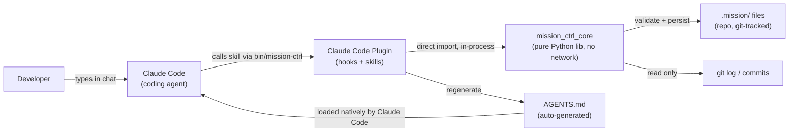
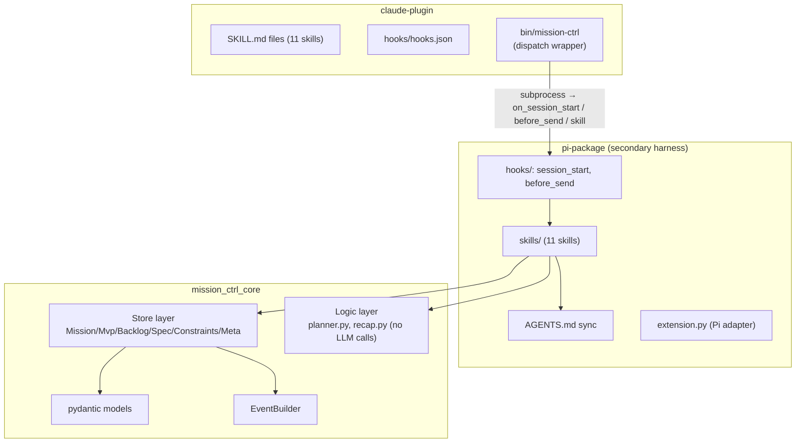
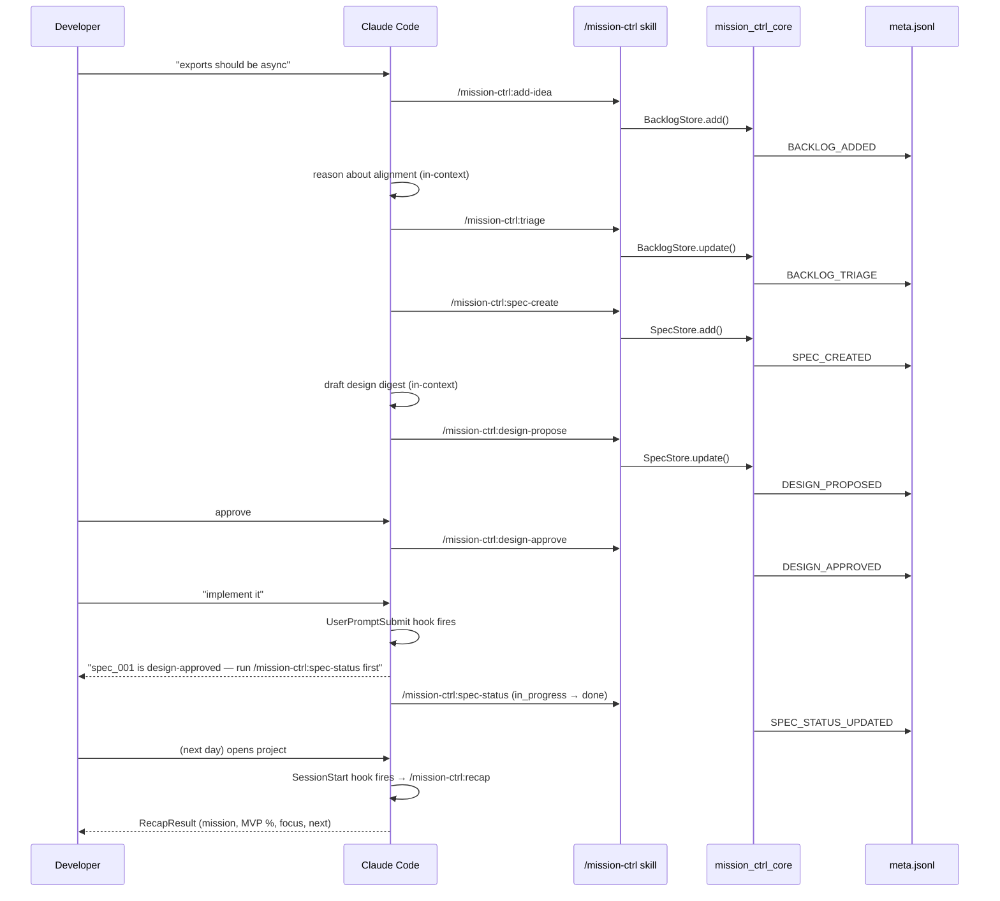
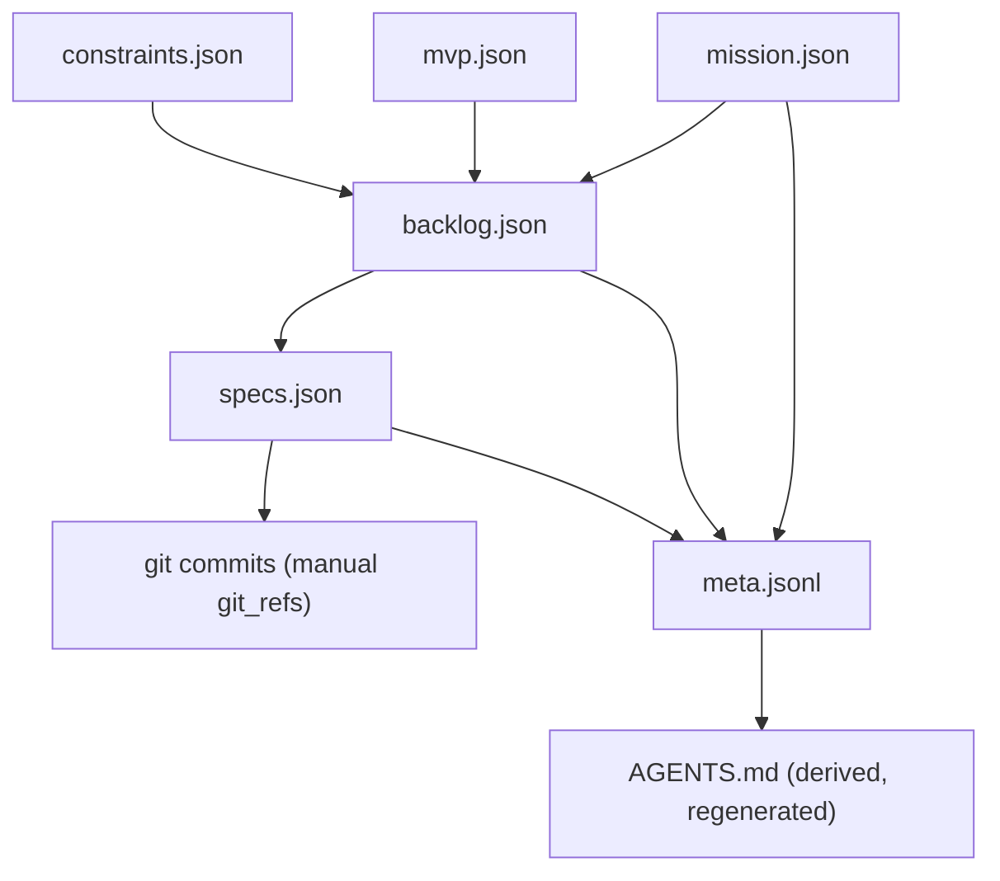

# Mission Ctrl — Architecture

Status: current source of truth.

---

## 1. System Context



No subprocess boundary in the critical path, no external network call anywhere. Claude Code is the agent — it reasons in its own context; core only validates and persists what the agent tells it.

The `pi-package` provides an equivalent adapter for Pi/openspec environments using the same core library and the same `.mission/` store format.

---

## 2. Component Diagram



`claude-plugin` delegates all logic to `pi-package` via `bin/mission-ctrl`. `mission_ctrl_core` is a standalone pip package — no agent-runtime dependency.

---

## 3. Data Flow — Core Loop



---

## 4. Data Model Relationships



File format (JSON/JSONL) is language-agnostic. Live samples in `docs/examples/domain/`.

---

## 5. Repository Layout

```
mission-ctrl/
├── packages/
│   ├── core/                        # mission_ctrl_core (Python, pip)
│   │   ├── mission_ctrl_core/
│   │   │   ├── models/              # pydantic models
│   │   │   ├── stores/              # IntentStore + sub-stores
│   │   │   ├── logic/               # planner.py, recap.py
│   │   │   └── stores/events.py     # EventBuilder
│   │   ├── tests/
│   │   │   └── fixtures/            # empty-project, mid-flight, complex-graph
│   │   └── pyproject.toml
│   │
│   ├── pi-package/                  # mission_ctrl_pi (secondary harness)
│   │   ├── mission_ctrl_pi/
│   │   │   ├── extension.py         # Pi adapter
│   │   │   ├── hooks/               # session_start.py, before_send.py
│   │   │   ├── skills/              # 11 skill functions
│   │   │   └── agents_sync.py       # AGENTS.md regeneration
│   │   ├── templates/               # agents_md.jinja2
│   │   └── pyproject.toml
│   │
│   └── claude-plugin/               # Claude Code plugin (primary surface)
│       ├── .claude-plugin/
│       │   └── plugin.json          # manifest (namespace: mission-ctrl)
│       ├── skills/                  # one SKILL.md per skill
│       ├── hooks/
│       │   └── hooks.json           # SessionStart + UserPromptSubmit wiring
│       ├── bin/
│       │   └── mission-ctrl         # dispatch wrapper (Python, stdlib-only)
│       └── README.md
│
├── docs/
│   ├── concept.md                   # why this tool exists
│   ├── architecture.md              # this file
│   ├── design.md                    # skill contracts, hooks, data model
│   ├── kanban.md                    # work items and proposals
│   ├── feedback.md                  # dogfood findings, bucketed
│   ├── proposals/                   # individual openspec proposal files
│   └── examples/
│
└── README.md
```

Runtime layout inside a user's project (unchanged): `.mission/*.json`, `.mission/meta.jsonl`, `AGENTS.md` at repo root, committed to git.

---

## 6. Design Decisions + Deferred Work

**What's deferred and why:**

| Item | Status | Why deferred |
|---|---|---|
| Distributing the plugin via Claude marketplace | Deferred | Requires publishing pipeline + versioning; local `--plugin-dir` sufficient for dogfood |
| `mutation-skills-10`: update-mission, add-mvp-item, add-constraint | Deferred | Store can be hand-edited for now; mutation skills are low-priority until judgment layer (proposal 18) shapes what mutations are needed |
| Semantic before-send classification | Deferred (proposal 20) | Requires judgment layer foundation first |
| Auto spec-completion detection | Deferred (proposal 21) | Requires environment signal wiring (git hook or CI) |
| Backlog merge / archive | Deferred | Not needed until backlog grows to 50+ items |
| Schema versioning / migration tooling | Deferred | No consumers on old schema yet |
| MCP visual spec graph server | Deferred | CLI surface sufficient; no pressing need for visual graph |

The `ts-bridge-07` proposal (Node → Python bridge for Pi) is superseded — `bin/mission-ctrl` calls Python directly, so no bridge is needed for Claude Code. If a true Node-side Pi adapter is ever needed, it would use the same bridge architecture, but that is not on the roadmap.
