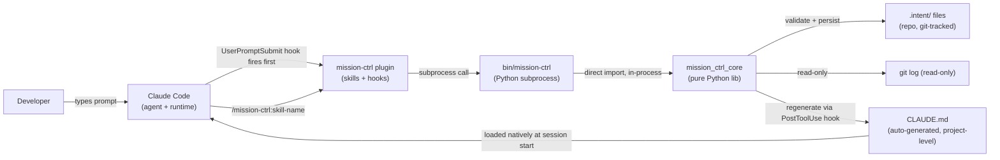
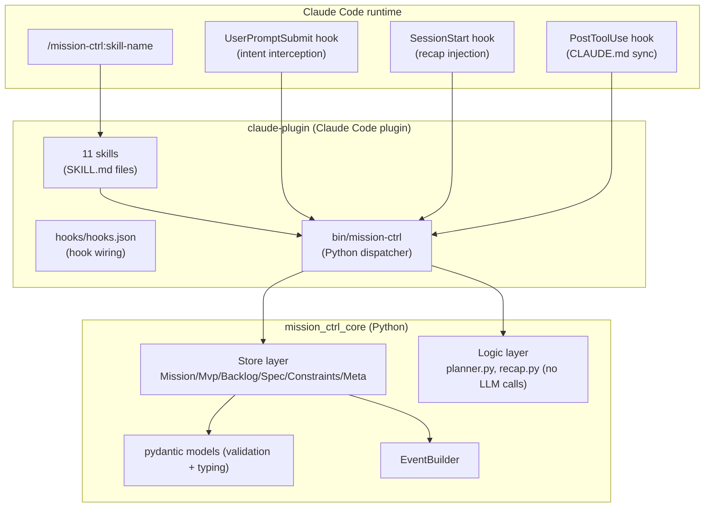
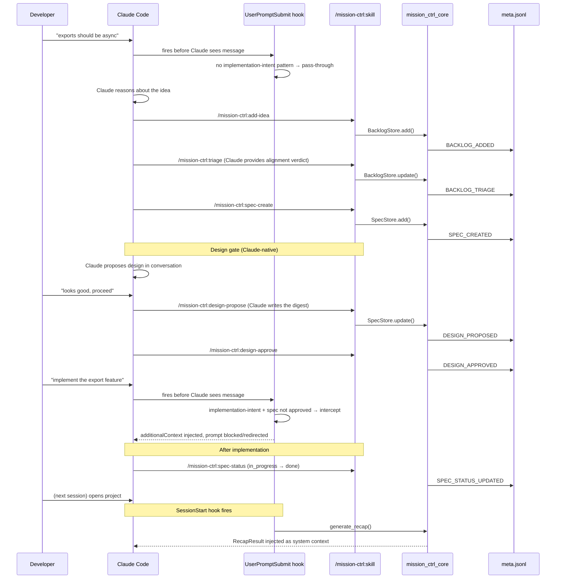
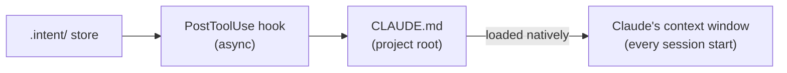
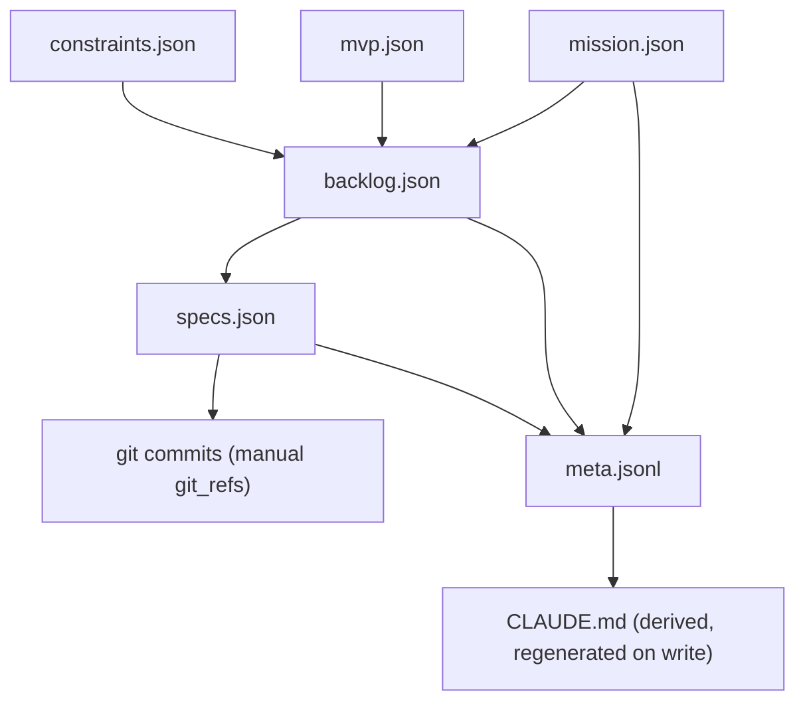

# Mission Ctrl — Claude Code Architecture
## Claude Code-native plugin. No bridge, no subprocess, no separate agent process.
Status: current source of truth for the Claude Code surface. Parallels `docs/architecture.md`
(Pi-focused) but reflects fundamentally different hook model, invocation path, and context delivery.

---

## Critical Difference: CLAUDE.md vs AGENTS.md

> **Action required.** Claude Code reads `CLAUDE.md`, not `AGENTS.md`. Mission-ctrl currently
> auto-generates `AGENTS.md` (inherited from the Pi design). For Claude Code, the sync target
> must be `CLAUDE.md` (project-level). See §3 for details.
>
> Workaround until the rename ships: add `@AGENTS.md` to your project's `CLAUDE.md`.

---

## 1. System Context



Claude Code is the only LLM in the system. It reasons in its own context; core only validates
and persists what Claude tells it. The plugin never calls an LLM — that constraint is unchanged
from the Pi design.

---

## 2. Component Diagram



The plugin is pure SKILL.md + hooks.json + a Python subprocess dispatcher. No Node.js, no
TypeScript, no bridge. Claude Code invokes skills via slash commands; hooks fire at lifecycle
points defined in hooks.json.

---

## 3. Hook Model — Pi vs Claude Code Comparison

This is the biggest architectural difference. Pi hooks fire inside the Python extension. Claude
Code hooks are shell commands wired via hooks.json that receive JSON on stdin and respond via
stdout/exit code.

| Pi behavior | Claude Code equivalent | Hook event | Can block? |
|---|---|---|---|
| `on_session_start` | Session recap injection | `SessionStart` | No (informational) |
| `on_before_send` (intercept impl intent) | Prompt interception | `UserPromptSubmit` | **Yes** (exit 2 blocks prompt) |
| Post-skill AGENTS.md sync | CLAUDE.md regeneration | `PostToolUse` (Bash matcher) | No |
| — | Design gate enforcement | `PreToolUse` (Edit/Write matcher) | **Yes** |

### hooks.json wiring

```json
{
  "hooks": {
    "SessionStart": [
      {
        "matcher": "startup|resume",
        "hooks": [{
          "type": "command",
          "command": "${CLAUDE_PLUGIN_ROOT}/bin/mission-ctrl hook session-start",
          "statusMessage": "Loading session recap..."
        }]
      }
    ],
    "UserPromptSubmit": [
      {
        "hooks": [{
          "type": "command",
          "command": "${CLAUDE_PLUGIN_ROOT}/bin/mission-ctrl hook before-send",
          "statusMessage": "Checking intent..."
        }]
      }
    ],
    "PostToolUse": [
      {
        "matcher": "Bash",
        "hooks": [{
          "type": "command",
          "async": true,
          "command": "${CLAUDE_PLUGIN_ROOT}/bin/mission-ctrl sync claude-md --cwd ${CLAUDE_PROJECT_DIR}"
        }]
      }
    ]
  }
}
```

### UserPromptSubmit — interception mechanics

The hook receives the full prompt on stdin and can:
- **Exit 2** → blocks the prompt entirely (erases it from Claude's view)
- **Return JSON with `updatedInput`** → replaces the prompt text
- **Return JSON with `additionalContext`** → prepends context to the prompt

This is strictly more powerful than Pi's `on_before_send`: Pi could only redirect or prepend;
Claude Code can rewrite or block outright.

```json
{
  "hookSpecificOutput": {
    "hookEventName": "UserPromptSubmit",
    "additionalContext": "⚠️ implementation-intent detected. spec_001 needs design approval before starting. Use /mission-ctrl:design-propose to log your proposed approach, then /mission-ctrl:design-approve to approve it.",
    "updatedInput": "[INTERCEPTED: backlog-first enforcement active]\n\nOriginal: implement the export feature"
  }
}
```

---

## 4. Data Flow — Core Loop (Claude Code)



---

## 5. Design Gate — The Key Difference from Pi

In the Pi design, Pi was expected to generate the "design digest" itself via its own reasoning.
In Claude Code, Claude writes the design proposal directly in the conversation thread:

1. Developer asks: "how should we approach the export feature?"
2. Claude proposes an approach (files, patterns, tradeoffs) in conversation.
3. Developer approves (or asks for changes) in conversation.
4. Claude calls `/mission-ctrl:design-propose` with a structured text summary of the agreed approach.
5. Developer (or Claude) calls `/mission-ctrl:design-approve` to formalize the gate.
6. Spec moves to `design_approved` status — only then can `in_progress` be set.

The digest text is Claude's own summary of the design it just proposed. This is more natural
than Pi's model because the design conversation already happened in context.

---

## 6. CLAUDE.md as the Agent Context Surface

Claude Code loads `CLAUDE.md` at every session start — it is the primary persistent context
mechanism. Mission-ctrl's auto-generated context file should target `CLAUDE.md`, not `AGENTS.md`.



### CLAUDE.md vs AGENTS.md resolution

| File | Read by | When |
|---|---|---|
| `CLAUDE.md` | Claude Code | Every session start, auto |
| `AGENTS.md` | Other agents (Cursor, Copilot, etc.) | Depends on tool |
| Both | Via `@AGENTS.md` import in `CLAUDE.md` | Claude Code defers to AGENTS.md content |

For teams using multiple tools, the recommended pattern is:
```markdown
# CLAUDE.md
@AGENTS.md

## Claude Code
[Claude-specific additions]
```

Mission-ctrl should generate `CLAUDE.md` (or write both). The template and sync target need
updating — tracked as tech debt until mutation-skills-10 or a dedicated rename change.

---

## 7. Data Model Relationships

Unchanged from Pi design — file format is agent-agnostic by design.



---

## 8. Repository Layout

```
mission-ctrl/
├── packages/
│   ├── core/                     # mission_ctrl_core (Python, pip)
│   │   ├── mission_ctrl_core/
│   │   │   ├── models/           # pydantic models
│   │   │   ├── stores/           # IntentStore + sub-stores
│   │   │   ├── logic/            # planner.py, recap.py
│   │   │   └── errors.py
│   │   └── pyproject.toml
│   │
│   └── pi-package/               # mission_ctrl_pi (Pi extension, still maintained)
│       └── ...
│
├── packages/claude-plugin/       # Claude Code plugin
│   ├── .claude-plugin/
│   │   └── plugin.json           # plugin manifest
│   ├── hooks/
│   │   └── hooks.json            # UserPromptSubmit, SessionStart, PostToolUse
│   ├── bin/
│   │   └── mission-ctrl          # Python dispatcher (no Node.js)
│   └── skills/
│       ├── init/SKILL.md
│       ├── add-idea/SKILL.md
│       ├── triage/SKILL.md
│       ├── spec-create/SKILL.md
│       ├── spec-status/SKILL.md
│       ├── design-propose/SKILL.md
│       ├── design-approve/SKILL.md
│       ├── recap/SKILL.md
│       ├── next/SKILL.md
│       ├── status/SKILL.md
│       └── log-feedback/SKILL.md
│
└── docs/
    ├── architecture.md           # Pi-focused
    ├── design.md                 # Pi-focused
    ├── concept.md
    ├── kanban.md
    └── claude/                   # ← this directory
        ├── architecture.md
        ├── concept.md
        └── design.md
```

---

## 9. Future Directions

### MCP integration (deferred)

A bundled MCP server could expose the intent store as tools, letting Claude call
`mcp__mission-ctrl__add_idea` directly without a subprocess boundary. The `mcp_tool` hook
type supports this natively. Deferred until the subprocess approach proves insufficient.

### Sub-agent patterns

Claude Code's sub-agent system enables natural extensions:
- **Design sub-agent**: isolated context for proposing a design digest without polluting the
  main conversation window
- **Recap sub-agent**: generates the session recap in a fork, injecting only the rendered
  output back into the session
- **Parallel triage**: fan out multiple backlog items to concurrent sub-agents for alignment
  scoring

These are v2 ideas — not scheduled until dogfood week surfaces the need.

### PreToolUse design gate

A `PreToolUse` hook on `Edit|Write` could enforce the design gate at the tool-call level
(block file edits if the active spec has no `design_approved` status). Currently the gate is
enforced only via `UserPromptSubmit` and conversation context. Tool-level enforcement is
strictly stronger but more disruptive.

---

## 10. Deferred / Non-Goals (Claude Code surface)

- No MCP server in v1 (subprocess + skills is sufficient)
- No TypeScript in the runtime path
- No LLM calls inside core
- No auto git-commit association
- No `PreToolUse` design gate enforcement in v1 (conversation-level only)
