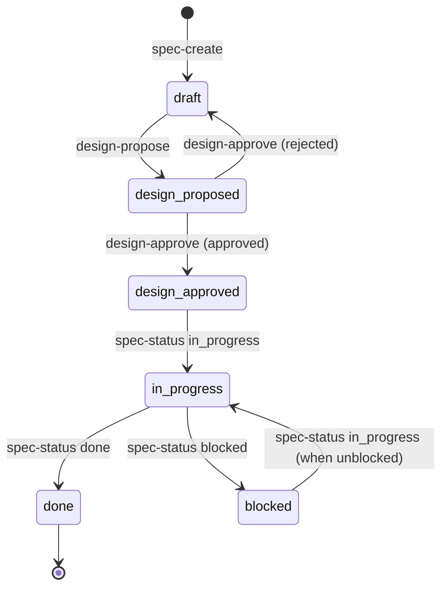

# Mission Ctrl — Design Doc (Claude Code edition)
## Components, skill contracts, hook behavior, CLAUDE.md sync, data model reference.
Status: current source of truth for the Claude Code surface.
Parallels `docs/design.md` (Pi) — updated for Claude Code's hook model, naming, and context delivery.

---

## 1. Component Responsibility Matrix

| Component | Responsibility | Depends on | Never does |
|---|---|---|---|
| `IntentStore` | Orchestrates all sub-stores, `init()`, `validate_all()` | Sub-stores | Business logic |
| `MissionStore` / `MvpStore` / `ConstraintsStore` | Read/write single JSON file, validate | pydantic models | Cross-file logic |
| `BacklogStore` | CRUD backlog items, ID generation | pydantic models | Alignment reasoning |
| `SpecStore` | CRUD spec nodes, cycle detection | pydantic models | Status-transition legality |
| `MetaStore` | Append-only event log I/O | pydantic models | Interpreting events |
| `EventBuilder` | Build valid MetaEvent objects | MetaStore | Decide *what* to log (caller decides) |
| `planner.py` | Rank unblocked specs | SpecStore, MvpStore | Talk to an LLM |
| `recap.py` | Assemble recap payload | All stores, git log (read-only) | Talk to an LLM |
| Claude Code Skills | Parse Claude's JSON input, call core, return typed result | `mission_ctrl_core` | Persist without core |
| `UserPromptSubmit` hook | Intercept implementation-intent, inject context | Skills, backlog state | Silently allow bypass |
| `SessionStart` hook | Inject recap at session open | Skills | Contain business rules |
| `PostToolUse` hook | Regenerate CLAUDE.md after intent writes | Store reads | Get edited manually |
| CLAUDE.md Sync | Regenerate project context file | Store reads | Accept manual edits |

**Rule:** Core is deterministic and network-free. All reasoning (alignment judgment, design
digest content) happens in Claude's context before calling a skill. Core validates and stores;
it does not generate.

---

## 2. Skill Set (11)

Invoked as `/mission-ctrl:<name>`. Claude Code shows the description in the `/` menu.

| Skill | Input | Output | Side Effects | Core call |
|---|---|---|---|---|
| `init` | project_name, mission? | Confirmation | Creates `.mission/`, templates, `INTENT_CREATED` | `IntentStore.init()` |
| `recap` | verbosity?, since_iso? | Formatted recap | None | `recap.generate_recap()` |
| `add-idea` | title, description? | idea_id | Writes `backlog.json`, `BACKLOG_ADDED` | `BacklogStore.add()` |
| `triage` | idea_id, bucket, **alignment_verdict (Claude-supplied)** | Classification | Updates `backlog.json`, `BACKLOG_TRIAGE` | `BacklogStore.update()` |
| `spec-create` | idea_id, title? | spec_id | Writes `specs.json`, `SPEC_CREATED` | `SpecStore.add()` |
| `spec-status` | spec_id, new_status, note? | prev/new status | Updates `specs.json`, `SPEC_STATUS_UPDATED` | `SpecStore.update()` |
| `design-propose` | spec_id, **digest text (Claude-supplied)** | Confirmation | Status → `design_proposed`, `DESIGN_PROPOSED` | `SpecStore.update()` |
| `design-approve` | spec_id, decision, notes? | Confirmation | Status transition, `DESIGN_APPROVED` | `SpecStore.update()` |
| `next` | — | Ranked specs | None | `planner.suggest_next()` |
| `status` | — | Dashboard | None | Reads all stores |
| `log-feedback` | category, description, severity, related_spec_id? | event_id | Appends `FEEDBACK_LOGGED` to meta.jsonl | `MetaStore.append()` |

### Design digest: what Claude should include

When calling `design-propose`, the `digest` field should be a structured summary:

```json
{
  "spec_id": "spec_001",
  "digest": "Approach: token-bucket rate limiting via middleware at src/api/middleware.py. Redis-backed for persistence across restarts. Key choices: (1) per-IP not per-user to avoid auth dependency; (2) Redis over in-memory to handle multi-process. Risks: adds Redis dep. Open: what limits per tier?"
}
```

This is written by Claude after the design conversation concludes — not generated by core, not
auto-inferred. Claude is the reasoning layer; core stores the outcome.

### alignment_verdict: what Claude should include

When calling `triage`, the `alignment_verdict` field is Claude's own assessment:

```json
{
  "idea_id": "idea_003",
  "bucket": "mvp",
  "alignment_verdict": "Required for launch: without rate limiting the API is trivially abusable. Directly blocks production readiness."
}
```

---

## 3. Data Model Reference

Format, IDs, timestamps, and field-level schema are unchanged from `docs/design.md §3`.
See that document for the full reference. Summary below for quick lookup.

### File summary

| File | Written by | Contains |
|---|---|---|
| `mission.json` | `/mission-ctrl:init` + mutation skills | mission_id, statement, success_criteria |
| `mvp.json` | `/mission-ctrl:init` + mutation skills | version, items (id, title, linked_specs) |
| `constraints.json` | `/mission-ctrl:init` + mutation skills | constraints (id, rule, severity, scope) |
| `backlog.json` | `add-idea`, `triage` | items (id, title, bucket, alignment, links) |
| `specs.json` | `spec-create`, `spec-status`, design-* | nodes (id, title, status, depends_on, links) |
| `meta.jsonl` | `EventBuilder` (every skill + hooks) | One JSON event per line, append-only |

### Spec status lifecycle



Dependency rule: cannot transition to `in_progress` unless all `depends_on` specs are `done`.

---

## 4. Event Catalog (v1 — Claude Code additions)

| Event Type | Emitted by | Decision Payload |
|---|---|---|
| INTENT_CREATED | `/mission-ctrl:init` | mission_version, mvp_version, constraints_version |
| BACKLOG_ADDED | `/mission-ctrl:add-idea` | title, bucket ("untriaged") |
| BACKLOG_TRIAGE | `/mission-ctrl:triage` | bucket, alignment {mission, mvp} |
| SPEC_CREATED | `/mission-ctrl:spec-create` | spec_title, status "draft", links |
| SPEC_STATUS_UPDATED | `/mission-ctrl:spec-status` | from, to |
| DESIGN_PROPOSED | `/mission-ctrl:design-propose` | digest_id, key_choices[], risks[], open_questions[] |
| DESIGN_APPROVED | `/mission-ctrl:design-approve` | digest_id, approval, notes? |
| SESSION_STARTED | `SessionStart` hook | gap_hours, verbosity |
| INTENT_INTERCEPTED | `UserPromptSubmit` hook | pattern_matched, redirect_target, original_message_excerpt |
| INTENT_BYPASS_USED | `UserPromptSubmit` hook | bypass_phrase, original_message_excerpt |
| FEEDBACK_LOGGED | `/mission-ctrl:log-feedback` | category, description, severity, related_spec_id? |

Deferred to v2: BACKLOG_MERGED, BACKLOG_ARCHIVED, SPEC_DEPENDENCY_UPDATED, DESIGN_REVISED,
INTENT_UPDATED, GIT_COMMIT_ASSOCIATED, BACKLOG_RESURFACED, CONSTRAINT_VIOLATION.

---

## 5. Hook Behavior (Claude Code)

### 5.1 SessionStart hook

**Trigger:** `SessionStart` event, matcher `startup|resume`

Fires at session open. Calls `generate_recap()` and returns the result as `additionalContext`
in the hook's JSON output. Claude Code prepends this to the first turn.

Verbosity tiers (same logic as Pi, different delivery mechanism):

| Gap since last meta.jsonl event | Verbosity | Content |
|---|---|---|
| < 1h | Ultra-brief | "Welcome back. `spec_001` still in progress." |
| 1–24h | Brief | Mission one-liner + last focus + next step |
| > 24h or first session | Full | Mission + MVP % + last focus + changes since + next + constraints |

Also appends `SESSION_STARTED` event to meta.jsonl.

Hook JSON output format:
```json
{
  "hookSpecificOutput": {
    "hookEventName": "SessionStart",
    "additionalContext": "[Mission Ctrl]\nMission: Keep sessions focused...\nIn Progress: spec_001 — Rate limiting\nNext: spec_002 — Auth refresh"
  }
}
```

### 5.2 UserPromptSubmit hook

**Trigger:** `UserPromptSubmit` event, no matcher (fires on every user message)

This is the intent interception gate. The hook receives the full prompt and checks it against
the hardcoded pattern list:

1. Match implementation-intent pattern ("implement X", "add X", "build X", "write X")
2. If matched:
   - Check if related idea is in backlog and triaged
   - Check if related spec exists and has `design_approved` status
   - If gate is not clear → inject redirect context (or block outright)
3. Log `INTENT_INTERCEPTED` or `INTENT_BYPASS_USED` event

**Intercept (soft):** inject `additionalContext` to redirect, let prompt through
```json
{
  "hookSpecificOutput": {
    "hookEventName": "UserPromptSubmit",
    "additionalContext": "⚠️ [Mission Ctrl] rate limiting (idea_003) exists in backlog but has no spec yet. Use /mission-ctrl:spec-create to create one, then /mission-ctrl:design-propose before implementing."
  }
}
```

**Block (hard):** exit 2 to erase the prompt entirely — reserved for cases where proceeding
would cause irreversible harm (e.g., implementing against an explicitly blocked spec). Not
used in v1 — soft interception only.

**Bypass:** if prompt contains the override phrase → log `INTENT_BYPASS_USED`, pass through.

### 5.3 PostToolUse hook

**Trigger:** `PostToolUse` event, matcher `Bash`, `async: true`

Fires after any Bash tool call (which is how skills execute). Regenerates `CLAUDE.md` from the
current intent store state. Async — does not block Claude's response.

The CLAUDE.md regen takes < 10ms via the Jinja2 template. Claude Code will see the updated
file in the next session (or immediately if `/context` is refreshed).

Implementation note: the hook uses `async: true` to avoid adding latency to every tool call.
If the write fails (e.g., no `.mission/` yet), it exits silently — the CLAUDE.md sync is
best-effort, not blocking.

---

## 6. CLAUDE.md as the Context Delivery Surface

### What gets generated

```markdown
<!-- Auto-generated by Mission Ctrl. Do not edit manually. -->

# Project Intent

## Mission
{mission.statement}

## MVP ({mvp.version}) — {done}/{total} Complete
- [x] {mvp item 1 — linked specs all done}
- [ ] {mvp item 2 — not yet}

## Constraints
- [critical] {constraint rule}
- [high] {constraint rule}

## Current Focus
{spec_id} — {spec title} [{status}]

## Next Up
- {spec_id} — {spec title}

## Backlog Summary
- MVP-critical: {count} / Parked: {count} / Untriaged: {count}

---
## Agent Instructions
1. All new ideas go to backlog first (/mission-ctrl:add-idea).
2. No implementation before design is approved (/mission-ctrl:design-propose → /mission-ctrl:design-approve).
3. Prefer MVP items over parked ideas unless explicitly overridden.
4. Respect constraints; if one must be broken, explain why via /mission-ctrl:next.
```

### CLAUDE.md vs global ~/.claude/CLAUDE.md

| File | Scope | Who writes it | Purpose |
|---|---|---|---|
| `~/.claude/CLAUDE.md` | All projects (user) | Developer | Personal preferences, style |
| `./CLAUDE.md` | This project | mission-ctrl (generated) | Project state + agent rules |
| `./CLAUDE.local.md` | This project, untracked | Developer | Personal sandbox notes |

The generated `CLAUDE.md` is committed to git — team members who use Claude Code on this
project automatically get the current intent state at session start. No manual sync needed.

### AGENTS.md compatibility

If your project uses `AGENTS.md` for other tools (Cursor, Codex, Copilot), add to `CLAUDE.md`:
```markdown
@AGENTS.md
```
Claude Code will load `AGENTS.md` content through the import. Mission-ctrl should eventually
write both files from the same template — tracked as a future improvement.

---

## 7. State Ownership Matrix

| File | Written by | Read by | Notes |
|---|---|---|---|
| mission/mvp/constraints.json | `/mission-ctrl:init`, mutation skills | All skills, CLAUDE.md sync | Write-once until mutation-skills-10 |
| backlog.json | `add-idea`, `triage` | `next`, `status`, CLAUDE.md sync | |
| specs.json | `spec-create`, `spec-status`, `design-*` | `next`, `recap`, `status` | |
| meta.jsonl | `EventBuilder` (every skill + hooks) | `recap` only | Append-only forever |
| CLAUDE.md | PostToolUse hook (derived) | Claude Code (auto-loaded) | Never commit manual edits |

---

## 8. Failure Handling

- Validation fails (pydantic) → typed exception with field-level errors → CLI surfaces to Claude
- Cycle detected in `depends_on` → reject, name the two spec IDs
- Illegal status transition → reject with the blocking spec ID
- `UserPromptSubmit` false positive → one-phrase override, logged as INTENT_BYPASS_USED
- `.mission/` not found → `NOT_INITIALIZED` error — direct to `/mission-ctrl:init`
- CLAUDE.md sync fails → silent (async hook, non-blocking) — state is correct, display may lag
- No silent auto-repair, ever

---

## 9. Open Decisions

1. **CLAUDE.md vs AGENTS.md**: should sync write both? Requires template update + naming change
   in the sync hook. Low-effort, high-value for teams with mixed tooling. Not scheduled.
2. **`UserPromptSubmit` false-positive rate**: hardcoded pattern list in v1. Pattern learning
   via feedback log deferred. Calibration via `FEEDBACK_LOGGED` events with `category: false_positive`.
3. **`PreToolUse` design gate**: enforce at Edit/Write tool level, not just prompt level.
   Strictly stronger but blocks legitimate exploratory edits. Opt-in via settings flag?
4. **Session boundary**: wall-clock gap only, or explicit `/mission-ctrl:session-end` skill?
5. **`.mission/` merge conflicts across branches**: undocumented. Recommend: always rebase intent
   files from trunk, treat them as trunk-only state.
6. **MCP exposure**: expose intent store as MCP tools for richer Claude Code tool-call integration.
   Requires bundled MCP server in plugin — deferred until subprocess proves insufficient.
