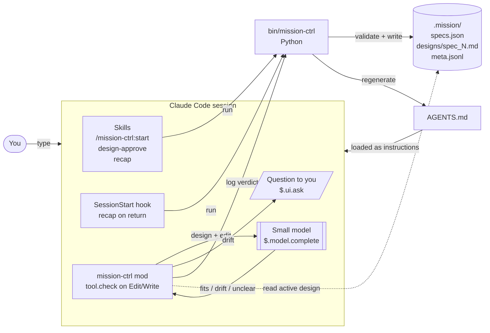
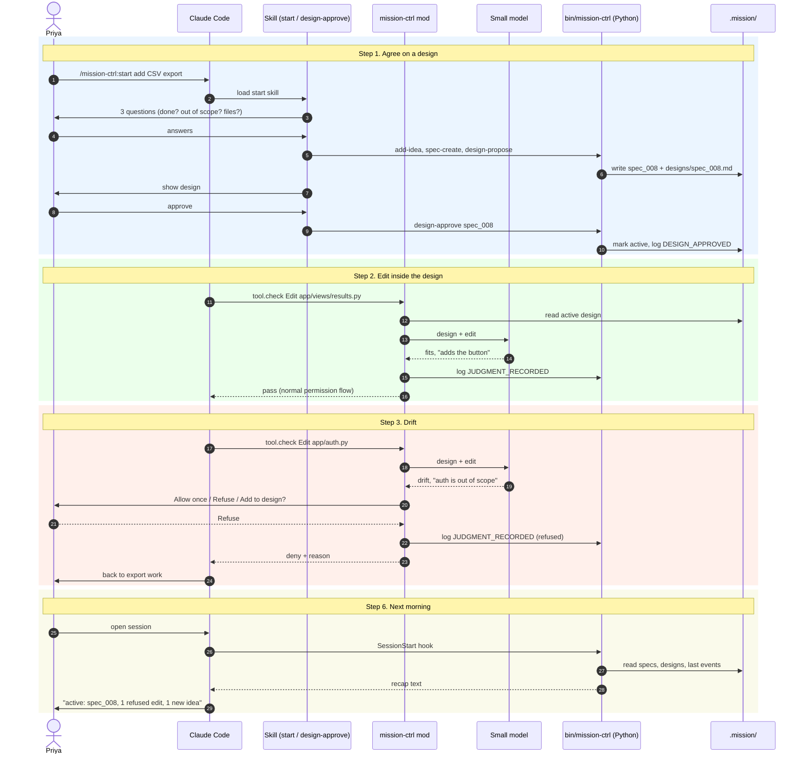
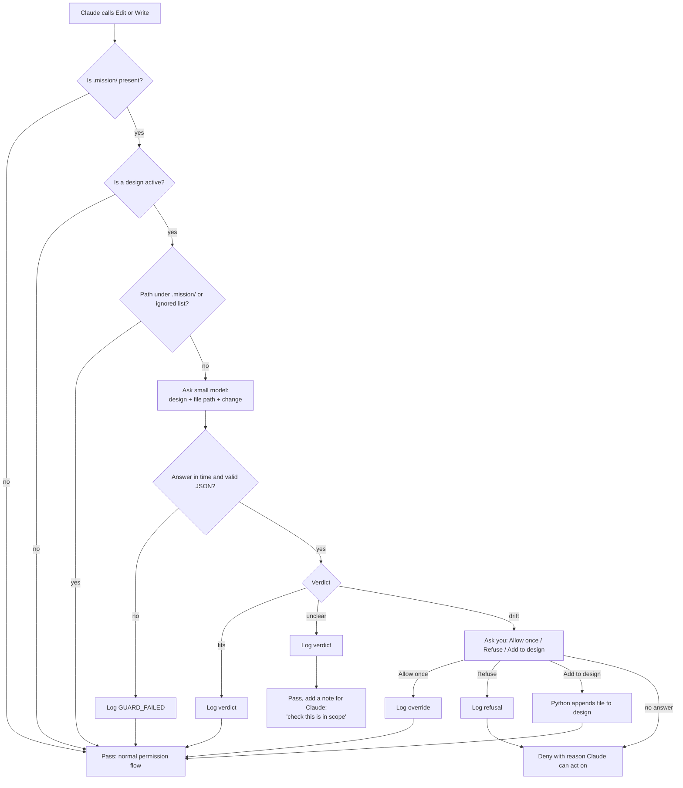
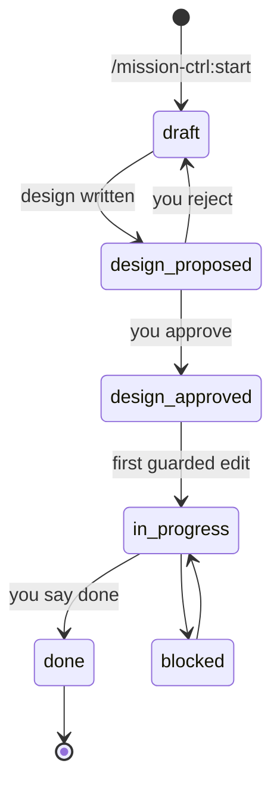

# mission-ctrl: Reset Report (2026-10-26)

**Reader:** someone who knows Claude Code a little and knows nothing about this project.
**Goal of this report:** say what mission-ctrl is, why it stalled, what we cut, and what we build this week.

---

## 1. The one-paragraph version

mission-ctrl is a Claude Code plugin. It keeps Claude on the plan you agreed on. You write a short design with Claude first. Then, each time Claude tries to edit a file, a small fast model compares the edit with the design. If the edit fits, nothing happens. If the edit drifts outside the design, Claude Code stops and asks you. When you come back the next day, mission-ctrl tells you where you left off.

That is the whole product for v2. Everything else waits.

---

## 2. What is wrong today (the honest audit)

### 2.1 What exists and works

| Part | State | Evidence |
|---|---|---|
| Python store (`.mission/*.json` + `meta.jsonl` event log) | Works | 208 tests pass (`uv run pytest`, today) |
| `bin/mission-ctrl` dispatcher (11 skills, 2 hooks) | Works | `status` runs in 0.5 s |
| `SessionStart` recap hook | Works | Used in the e2eeval dogfood |
| `UserPromptSubmit` keyword hook ("implement", "build", ...) | Works as coded, **fails as a product** | See 2.3 |
| Design gate (`design-propose` → `design-approve`) | Records a status flip only | See 2.4 |

### 2.2 The numbers

- 59 commits. About 15 open OpenSpec proposals. **0 of 3 MVP items done.**
- About 2,900 lines of docs in `docs/`. About 2,500 lines of product code.
- One real dogfood project (e2eeval, 76 events). It produced 8 feedback items. 5 are fixed.

The project wrote more about the product than it built.

### 2.3 The keyword hook hurt more than it helped

These are the real `INTENT_INTERCEPTED` events from the e2eeval dogfood log:

| What you typed | What mission-ctrl did | Was that right? |
|---|---|---|
| "How ready are we to implement CR-4?" (3 times) | Blocked. Told you to add an idea. | No. It was a question. |
| "Let's implement" | Blocked. | No. The design was already approved. |
| "implement" | Blocked. | No. Same reason. |
| "override and implement" | Blocked. | No. You tried to get past it. |

6 blocks, 0 useful. You typed the bypass phrase 3 times. Each fix (F2, F3, F7) added another rule. The rules keep growing, and the hook still cannot tell a question from a request.

**And it guards the wrong thing.** It reads your prompt. But drift does not come from your prompt. It comes from Claude's edits. If you say "go ahead", no keyword matches, and Claude can edit any file it wants.

### 2.4 The design gate stores nothing useful

`design-propose` takes your design text. Then it keeps only the **first 64 characters** in the event log (`events.py:156`). `key_choices`, `risks`, and `open_questions` are always empty lists. Nothing later reads the design. So "design approved" means "someone ran a command". It does not mean "edits must match this design".

### 2.5 The process cost is too high

To start one piece of work today, you run five skills in order:

```text
add-idea → triage → spec-create → design-propose → design-approve
```

`spec-create` refuses an idea that is not triaged. A small fix pays the same toll as a new feature. Nobody will do this on a busy day.

### 2.6 The root cause

Early on we made two "pragmatic" rules:

- **con_001 "No LLM calls inside core."** So every decision that needs judgment became a keyword rule or a manual skill call.
- **con_002 "No Node.js in the runtime path."** So the one tool that can watch Claude's edits and call a small model (a Claude Code **mod**, which is JavaScript) was off the table.

Together, these rules removed the brain and the hands. What was left was a bookkeeping tool that asks the human to do all the judging. The feedback log says the same thing in its own words: *"The agent records but never infers."*

---

## 3. Dogma review: keep, change, or drop

| Rule | Where it lived | Verdict | Why |
|---|---|---|---|
| con_001 No LLM in core | constraints | **Dropped** (done 2026-10-17) | It blocked the product's main feature. |
| con_002 No Node.js in runtime | constraints | **Dropped today** | Its reason (TS bridge deferred) is gone. A mod runs inside Claude Code's own engine and has no Node.js APIs. We ship no Node process. |
| con_003 No features before dogfood week | constraints | **Dropped** (done 2026-10-17) | The week is done. |
| "All ideas go to backlog first" | `AGENTS.md` rule 1 | **Changed** | Now: offer to log the idea, then keep going. Never block. |
| "No implementation before design approval" | `AGENTS.md` rule 2 | **Changed** | Now: only for work that adds a feature or changes behavior. Small fixes, docs, and tests skip it. The LLM guard enforces scope, not a rule list. |
| "Prefer MVP over parked ideas" | `AGENTS.md` rule 3 | **Dropped** | It fights every change of direction, including this one. |
| "Respect constraints, explain via /next" | `AGENTS.md` rule 4 | **Kept, simpler** | Say which constraint and why, before you act. No skill call. |
| Keyword `UserPromptSubmit` hook | `hooks.json` | **Turn off on day 1** | 6 of 6 blocks were wrong (section 2.3). The edit guard replaces it. |
| "Second host (Pi), keep core host-agnostic" | docs, `pi-package` | **Dropped** | Two hosts doubled the work and neither shipped. |
| Two proposal systems (OpenSpec + `/mission-ctrl` specs) | repo | **Pick one per job** | OpenSpec = how *we* plan mission-ctrl. `.mission/` = what the *product* does for users. Do not dogfood both on the same change. |
| Your global gates (web search for every fact, skill load before mod work, sign-off before build) | `~/.claude/CLAUDE.md` | **Your call. Suggestion below.** | They improve accuracy. They also make every small question slow. |

**Suggestion for your global gates.** Keep the web-search gate for API and feature facts (it caught real version limits today: mods need v2.1.287, and this machine runs v2.1.280). Drop it for questions about this repo's own code. Keep design sign-off for new features only.

### New constraints (written to `.mission/constraints.json`)

| ID | Rule | Why |
|---|---|---|
| con_004 | Claude Code is the only host | One target until the MVP works. |
| con_005 | The guard fails open | A timeout or model error must never block your edit. |
| con_006 | Python owns every write to `.mission/` | One write path keeps the store valid. The mod may read files. |
| con_007 | Every LLM verdict is logged with its reason | We need the record to tune the judge and build evals. |

### Review of your proposed intent

Your draft was close. Three changes:

1. **"Judge whether each action fits"** is too wide. Judge `Edit` and `Write` only. Reads, searches, and tests are not drift, and judging them adds delay and cost with no gain.
2. **"Show a short recap when the session ends"** will not work well. A `SessionEnd` hook gets a 1.5 s budget, cannot call a model as a prompt hook, and you are closing the window anyway. Show the recap when you **come back** (the `SessionStart` hook already does this).
3. **"MVP: the design gate on edits"**. Agreed. That is the MVP.

---

## 4. The new product in one picture



| Box | Job | Language |
|---|---|---|
| Skills | Talk with you. Write the design. Approve it. Show the recap. | Markdown (`SKILL.md`) |
| SessionStart hook | Print the recap when a session opens. | Python, already built |
| Mod | Catch each `Edit`/`Write`. Ask the small model. Ask you on drift. | JavaScript, about 100 lines |
| Small model | Read the design and the edit. Return a verdict and one reason. | Claude (Haiku-class), billed to your session |
| `bin/mission-ctrl` | Every store write. Schema checks. Event log. | Python, already built |
| `.mission/` | The plan, the designs, the event log. In git. | JSON + Markdown |

**Brain:** the small model makes the judgment call. **Memory:** Python and `.mission/`. **Hands:** the mod.

---

## 5. User story: Priya adds CSV export

Priya maintains a small Python dashboard. She uses Claude Code every day. She installed mission-ctrl last week.

### Step 1: Priya starts the work

> **Priya:** `/mission-ctrl:start add CSV export to the results page`

The `start` skill runs. Claude asks three short questions: what done looks like, what is out of scope, and which files she expects to change. Then it writes a design and shows it:

```markdown
# spec_008: CSV export on the results page
Goal: a "Download CSV" button on /results that exports the visible table.
In scope: results page view, a new export helper, its test.
Out of scope: Excel format, scheduled exports, auth changes.
Expected files: app/views/results.py, app/export.py (new), tests/test_export.py (new)
```

Priya types `approve`. Claude runs `design-approve`. The design is now **active**.

*Behind the scenes:* one skill made four store writes (idea, spec, design, approval). Python wrote `.mission/designs/spec_008.md` and logged each step in `meta.jsonl`. Before v2, this took five separate skill calls.

### Step 2: Claude edits inside the design

Claude edits `app/views/results.py` to add the button.

*Behind the scenes:* the mod catches the `Edit` call. It sends the design and the edit to the small model. The model says `fits: the edit adds the button the design names`. The mod logs the verdict and lets the edit through. Priya sees nothing. This takes about 1–2 s.

### Step 3: Claude drifts

While it works, Claude notices the login check looks old. It tries to edit `app/auth.py`.

*Behind the scenes:* the mod asks the small model. The model says `drift: auth changes are out of scope`. The edit pauses. Priya sees:

```text
mission-ctrl: This edit is outside spec_008 (auth changes are out of scope).
  1. Allow once
  2. Refuse
  3. Add to design
```

Priya picks **Refuse**. Claude reads "The user refused this edit: auth changes are out of scope for spec_008" and goes back to the export work.

### Step 4: Priya captures the idea instead

Claude says the login check still looks old. Priya says "log it". Claude runs `add-idea`. The idea goes to the backlog. Work on spec_008 continues. Nothing blocks.

### Step 5: Priya closes for the day

She commits and closes the terminal. Nothing special happens. The event log already holds the design, five verdicts, one refusal, and one new idea.

### Step 6: Priya comes back the next morning

She opens Claude Code. The `SessionStart` hook prints:

```text
mission-ctrl · active: spec_008 CSV export (in progress, 14 h ago)
  Last: 5 edits checked, 1 refused (app/auth.py, out of scope)
  New idea: idea_011 "update login check"
```

She knows where she is in five seconds. She types "finish the CSV tests" and work goes on.

---

## 6. Sequence diagram: the whole story



---

## 7. The guard's decision, step by step



Two design choices to note:

- **Fail open on errors** (con_005). A broken guard must not stop your work.
- **`unclear` does not ask you.** Only a clear `drift` interrupts you. This keeps false asks low. We tune this with the dogfood data.

---

## 8. Spec life cycle (what the states mean now)



`design_approved → in_progress` now happens on its own, at the first edit the guard checks. You do not run `spec-status` for it.

---

## 9. User stories (acceptance tests for the week)

Each story has a check you can run by hand or as a `claude plugin eval` case.

| # | As a ... | I want to ... | So that ... | Done when |
|---|---|---|---|---|
| US1 | developer starting work | agree on a design in one command | I do not run five skills | `/mission-ctrl:start` ends with an approved spec and `designs/spec_N.md` |
| US2 | developer in flow | have in-scope edits pass silently | the tool stays out of my way | An edit to an expected file gets `fits`, no prompt, under 3 s |
| US3 | developer | be asked when Claude edits outside the design | I catch drift before it lands | An edit to an out-of-scope file shows the 3-option question |
| US4 | developer | widen the design from the question | a valid change does not need a new spec | "Add to design" appends the path and the edit goes through |
| US5 | developer | log a side idea without stopping | I keep focus and keep the idea | `add-idea` works with no active spec and does not change the spec |
| US6 | developer making a small fix | skip the design step | small work stays cheap | With no active design, the guard never asks |
| US7 | returning developer | see the active design and last verdicts | I restart in seconds | `SessionStart` recap names the spec, refusals, and new ideas |
| US8 | maintainer of mission-ctrl | see every verdict and reason | I can tune the judge | Each guarded edit adds one `JUDGMENT_RECORDED` line to `meta.jsonl` |

---

## 10. OpenSpec proposals: what to do with each

| Proposal | Verdict | Reason |
|---|---|---|
| `design-gate-enrichment-22` | **Do now (part of MVP 1)** | Store the full design, not 64 characters. Drift detection is now the guard itself. |
| `spec-template-25` | **Do now, smaller** | Use a 4-part template the judge can read: Goal, In scope, Out of scope, Expected files. Six sections is too heavy for small work. |
| `judgment-layer-18` | **Do now, much smaller** | Keep only `JUDGMENT_RECORDED` and the `JudgmentResult` shape. No `/judge` skill, no `judge.yaml`. One judge: the edit guard. |
| `launch-skill-11` | **Merge into `/mission-ctrl:start`** | Same idea: talk first, then write. Scope it to one piece of work, not project setup. |
| `semantic-intent-20` | **Replace** | Guard edits, not prompts. Turn off the keyword hook. |
| `auto-advancement-21` | **Week 2, phase 1 only** | The recap can say "spec_008 has 3 commits, mark done?" No git convention yet. |
| `design-grilling-26` | **Week 2** | Good idea. `start` asks 3 questions first. Grill later if designs come out thin. |
| `store-mvp-tracking-15` | **Defer** | MVP % is a nice number. It does not keep anyone on task. |
| `mutation-skills-10` | **Defer** | Hand-edit JSON for now. It worked today. |
| `backlog-planner-integration-16` | **Defer** | Backlog ranking is not the product. |
| `mid-project-init-17` | **Defer** | `start` works in any repo, new or old. That covers adoption. |
| `insights-12` | **Defer** | Needs weeks of verdict data first. US8 creates that data. |
| `auto-triage-19` | **Reject for v2** | Triage is backlog management. Not focus. |
| `tracker-config-24` | **Reject for v2** | External trackers add a second system to keep in sync. |
| `dogfood-ship-v0-1-05` | **Archive** | Written for Pi. Replace with MVP 3. |
| `claude-plugin-08` | **Archive as applied** | Its open tasks point at `ts-bridge-07`, which is superseded. |
| `session-handoff-23` | **Reject** | Kanban-only row. Use the existing `handoff` skill. |

---

## 11. The one-week plan

**Blocker for day 1:** mods need Claude Code v2.1.287 or later. This machine runs **v2.1.280**. Run `claude update` first.

| Day | Work | Done when |
|---|---|---|
| 1 | Update Claude Code. Remove the `UserPromptSubmit` keyword hook. Write an empty mod that loads and logs each `Edit`. **Measure** `$.model.complete` time with a Haiku-class model on a fake design. | `/plugin` shows `1 mod active`. You have a latency number. |
| 2 | Python: `design-propose` writes `.mission/designs/<spec>.md` in full. `design-approve` sets the active spec. New `mission-ctrl design active` prints it as JSON. New `mission-ctrl log judgment` appends `JUDGMENT_RECORDED`. Tests for both. | US8 log line appears from the CLI. Tests pass. |
| 3 | Mod: `tool.check` on `Edit`/`Write`. Read the active design. Call the model. Ask on `drift`. Add a `.catch` that fails open. | US2, US3, US4 pass by hand. |
| 4 | Skill: `/mission-ctrl:start`. Recap: add active design and last verdicts. Write 6–8 `claude plugin eval` cases from the stories. | US1, US6, US7 pass. `claude plugin eval` runs. |
| 5 | Dogfood on e2eeval for a real task. Count false asks and missed drift. Tune the judge prompt. | A short results table in `docs/dogfood-v2.md`. |

**Plan B if the mod path fails** (version, policy, or the API acts in a way we did not expect): use a settings hook of `type: "agent"` on `PreToolUse` with matcher `Edit|Write`. An agent hook can read `.mission/designs/` with the Read tool and return `ok: false` with a reason. On `ok: false`, Claude gets the reason as a tool error and can adjust. You lose the 3-option question and it is slower (default 60 s timeout, multi-turn), and agent hooks are marked experimental. But it needs no JavaScript.

### What we measure at the end of the week

| Metric | Target |
|---|---|
| Added delay per guarded edit (median) | under 3 s |
| False asks (you said "Allow once" because the edit was fine) | under 1 in 10 edits |
| Missed drift (you found an out-of-scope edit in review) | count it, aim for 0 |
| Time from install to first guarded edit | under 10 min |

If the false-ask rate is high, fix the prompt and the template before you add any feature.

---

## 12. Repo cleanup (needs your OK, not done)

These are deletions and moves. I did not do them. Confirm and I will make each one a separate commit.

1. Commit the pending OpenSpec archive moves (`ts-bridge-07`, `log-feedback-06`, `mvp-completion-fix-13`). They are already moved on disk.
2. Delete Pi-only files: `.pi/`, `packages/pi-package/extension.py`, `packages/pi-package/package.json`, `openspec/specs/pi-hooks/`.
3. Later (not this week): rename `packages/pi-package` → `packages/plugin-py`. `bin/mission-ctrl` imports it, so this is a real code change.
4. Collapse docs. Keep `README.md`, this report, `docs/handoff.md`, `docs/feedback.md`, and one `docs/decisions.md`. Move `docs/concept.md`, `docs/design.md`, `docs/architecture.md`, `docs/claude/`, `docs/scratchpad.md`, `docs/kanban.md`, and `docs/proposals/` to `docs/archive/`.
5. Close or archive the OpenSpec changes marked Defer, Reject, or Archive in section 10.

---

## 13. What changed in the repo today

| File | Change |
|---|---|
| `.mission/mission.json` | New mission (v2.0) and 4 success criteria |
| `.mission/mvp.json` | New 3 MVP items: store design, edit guard, 5-day dogfood |
| `.mission/constraints.json` | Removed con_002. Added con_004 to con_007. |
| `packages/pi-package/templates/agents_md.jinja2` | New agent rules (section 3) |
| `packages/pi-package/tests/snapshots/agents_md_mid_flight.md` | Snapshot updated for the new rules |
| `AGENTS.md`, `intent/intent.md` | Regenerated from the store with `bin/mission-ctrl` and `write_intent_md` |
| `intent/mission-ctrl.md` | Rewritten for v2 |
| `docs/reset-2026-10-26.md` | This report |

All 208 tests pass after these changes. Nothing is committed.

---

## 14. Assumptions to confirm

1. **A JS mod is fine.** You said a mod does not count as Node. I removed con_002 on that basis.
2. **A Haiku-class model is good enough to judge scope** from a 4-part design and one edit. Day 1 tests the speed. Day 5 tests the quality.
3. **Judge only `Edit` and `Write`.** Not `Bash`. Claude can still change files through shell commands (`sed`, `>`). Add `Bash` later if the dogfood shows that gap.
4. **You are OK with model cost per edit.** Each guarded edit is one small model call billed to your plan.

---

## Sources

- [Mods overview](https://code.claude.com/docs/en/plugins/mods): v2.1.287 minimum; mods run inside Claude Code
- [React to events with a mod](https://code.claude.com/docs/en/plugins/mods/events): `tool.check`, `tool.call`, `$.ui.ask`, `.catch` to fail open or closed
- [Use the mods API](https://code.claude.com/docs/en/plugins/mods/api): `$.model.complete`, `$.fs`, `$.process.run` (30 s default), no Node.js APIs in the hooks module
- [Hooks reference](https://code.claude.com/docs/en/hooks): prompt and agent hook events, `ok`/`reason` schema, `SessionStart` supports only command and `mcp_tool` hooks, `SessionEnd` 1.5 s budget
- [Test plugins with evals](https://code.claude.com/docs/en/plugin-evals): `evals/` layout, `tool_used` and `llm` graders, v2.1.269 minimum
